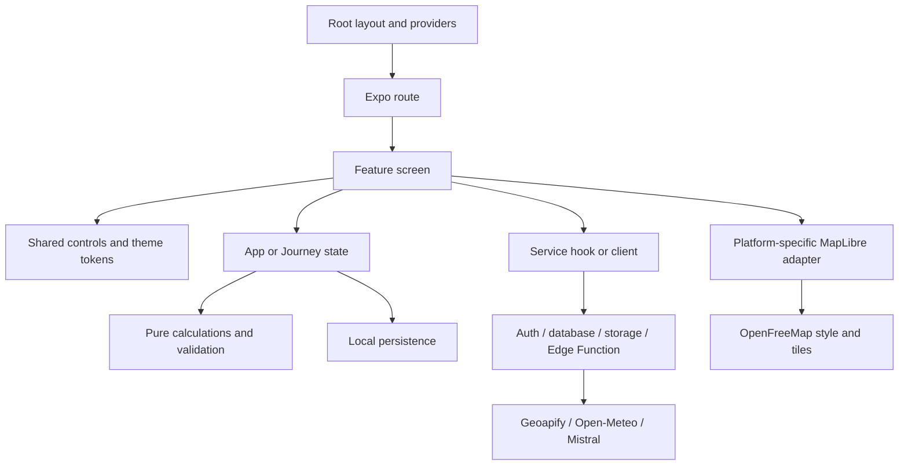
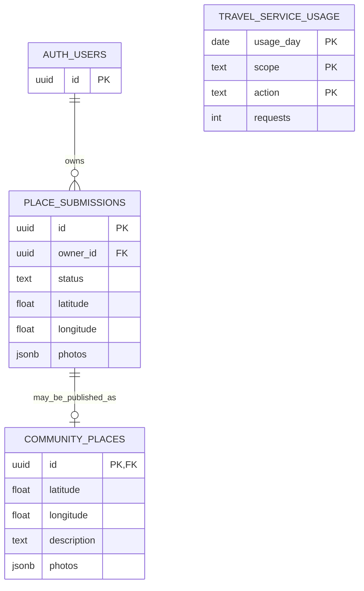
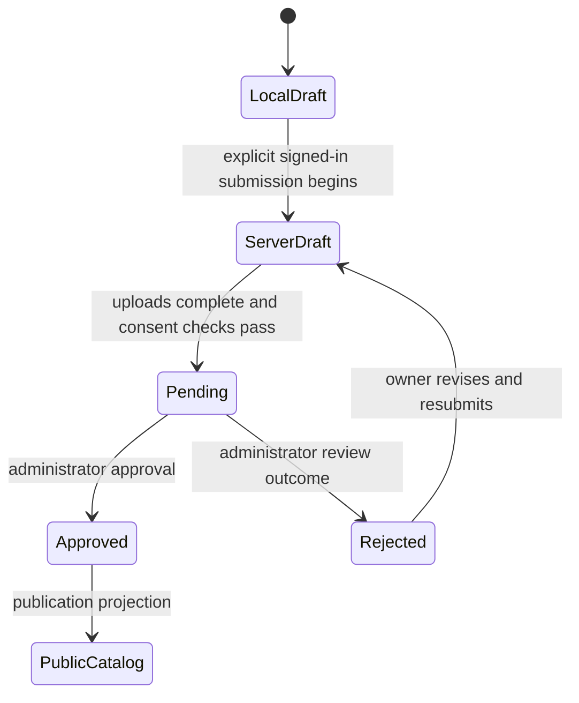

# MAPPER master learning document

Learn the language, understand every app page, follow the database, and judge the implementation before changing it.

**Source reviewed:** `feature/woven-theme`, application source inherited from `32b4ad8`; reviewed on **6 November 2026**. This is a source-reading review and a documentation change. No app behavior, database structure, environment values or hosted services were changed. Examples explicitly marked **proposed** are lessons, not implemented features.

Use this as the explanation book. Keep the [file/function study guide](study-guide.md) open beside it as the complete source index. That index lists the files, named functions and definition links; this document explains how to think about them. Neither document replaces reading the code and its tests.

## Contents

1. [What this project is, and whether it follows good principles](#1-what-this-project-is-and-whether-it-follows-good-principles)
2. [The languages and tools you need](#2-the-languages-and-tools-you-need)
3. [How to read TypeScript and React](#3-how-to-read-typescript-and-react)
4. [How the whole app connects](#4-how-the-whole-app-connects)
5. [Every production page, in user-flow order](#5-every-production-page-in-user-flow-order)
6. [Sheets, panels and alternative design pages](#6-sheets-panels-and-alternative-design-pages)
7. [Where data lives](#7-where-data-lives)
8. [Understand the actual database](#8-understand-the-actual-database)
9. [How to change the database and code together](#9-how-to-change-the-database-and-code-together)
10. [Maps, routing, weather and AI](#10-maps-routing-weather-and-ai)
11. [Evidence-based principles review](#11-evidence-based-principles-review)
12. [How to investigate an error](#12-how-to-investigate-an-error)
13. [Your learning sequence and exercises](#13-your-learning-sequence-and-exercises)
14. [Commands and the maintenance checklist](#14-commands-and-the-maintenance-checklist)

## 1. What this project is, and whether it follows good principles

MAPPER is an Expo/React Native application for discovering places around Hubballi, Dharwad and Belagavi. The production app uses the selected blue Discovery Lens design, with light/dark appearance. It also contains a separate browser gallery of other designs.

**Yes, several good principles are already present. No, it would be inaccurate to say every file follows best practice or that the app is fully production-validated.** The strongest parts are typed feature models, pure travel/filter functions, separate storage/network adapters, guarded persistence, private contribution policies and backend-only provider secrets. The weaker parts include some large screen components, duplicated persistence patterns, incomplete database typing, manual response assertions, and limited automated rendering/device coverage.

Those are findings from the current source, not a claim that a framework or a folder structure automatically guarantees quality. The [review below](#11-evidence-based-principles-review) identifies specific files, reasons and proportionate improvements. No numerical quality score can establish correctness; a passing test or a documented assumption is better evidence.

### What is implemented versus what needs setup

| Capability                                     | Current code behavior                                           | What to remember                                                     |
| ---------------------------------------------- | --------------------------------------------------------------- | -------------------------------------------------------------------- |
| Regional places, search and filters            | Bundled catalog and pure filtering                              | Coverage and estimates are deliberately limited                      |
| Bookmarks and one day plan                     | Saved locally                                                   | No cloud backup or account synchronization                           |
| Destination journey                            | Start, destination, optional stops and illustrative estimates   | Separate from the My plan tab                                        |
| Community drafts                               | Local metadata and locally stored photos                        | Local privacy is not encrypted storage or a cloud backup             |
| Submission and reviewed publication            | Supabase code, SQL policies and administrator approval function | Hosted migration/configuration must actually be applied              |
| Basemap                                        | MapLibre with OpenFreeMap                                       | Independent of Supabase travel services                              |
| Road routes, address search, forecast, real AI | Implemented optional authenticated service path                 | Needs working backend deployment, provider configuration and account |
| Example assistant                              | Local labelled sample answers                                   | No live model call                                                   |
| Offline map download and offline rerouting     | Future work                                                     | Cached place records do not include a road graph                     |

The [previous repository verification](study-guide.md#repository-verification) established source/CI status, not hosted-service functionality. This review makes no new deployment or device-test claim.

## 2. The languages and tools you need

| Name               | What it is                                   | Where you meet it                                | Learn first                                                    |
| ------------------ | -------------------------------------------- | ------------------------------------------------ | -------------------------------------------------------------- |
| JavaScript         | Runtime programming language                 | App logic, scripts, browser gallery              | Variables, objects, arrays, functions, modules, promises       |
| TypeScript         | JavaScript with static type checking         | Most `.ts` and `.tsx` files                      | Types, interfaces, unions, null handling, narrowing            |
| JSX / TSX          | Syntax describing a component tree           | Screen and UI files                              | Props, children, conditional rendering, list keys              |
| React              | Component and state model                    | Components, hooks, context                       | Render, state, events, effects and shared ownership            |
| React Native       | UI framework for native platforms            | `View`, `Text`, `Pressable`, lists               | Layout, accessibility, safe areas, platform behavior           |
| Expo / Expo Router | App tooling and file-based navigation        | `src/app`, `app.json`, package scripts           | Routes, layouts, development server versus export              |
| SQL                | Database definition and query language       | `supabase/migrations/*.sql`                      | Tables, constraints, joins, privileges, RLS and transactions   |
| PL/pgSQL           | PostgreSQL procedural language               | Validation, approval and quota functions         | Variables, conditions, locks and exceptions                    |
| JSON               | A text representation of data                | API bodies, saved snapshots and config           | Objects/arrays; parsing does not validate the schema           |
| CSS                | Browser styling language                     | Map CSS and `design-exploration`                 | Selectors, layout, responsive rules                            |
| PowerShell         | Your Windows command shell                   | Commands you run in a terminal                   | Working directory, arguments, environment and process lifetime |
| Deno / Node        | JavaScript/TypeScript execution environments | Deno: Edge Function; Node: tooling/Metro/scripts | Same language does not mean same available APIs or secrets     |
| Git / GitHub       | History and remote collaboration             | Commits, branches, reviews and CI                | Diff, commit, branch, pull and ordinary push                   |

The PHP files visible in the editor belong to another project. They do not control MAPPER. You do not need to learn PHP to understand this app.

Read the [TypeScript everyday-types chapter](https://www.typescriptlang.org/docs/handbook/2/everyday-types.html) for basic type syntax, and React's [Thinking in React](https://react.dev/learn/thinking-in-react) for component decomposition and state ownership. The examples below apply those ideas to this repository.

### Three execution environments

1. **Phone/browser:** renders the app and holds public configuration. Anything bundled here must be treated as readable by the user.
2. **Supabase backend:** verifies identity, enforces quotas, holds private provider keys and calls external services.
3. **Your PC tooling:** installs dependencies, runs checks, bundles assets and optionally tests provider keys. A successful PC script does not automatically configure the phone app.

## 3. How to read TypeScript and React

### Values, types and interfaces

This simplified learning example uses the same concepts as [place types](../src/features/places/types.ts):

```ts
type Transport = 'walking' | 'bicycle' | 'motorbike' | 'car';

interface Coordinates {
  latitude: number;
  longitude: number;
}

function formatVisit(minutes: number): string {
  return `${minutes} min`;
}
```

`type Transport` permits four spellings. `interface Coordinates` describes an object. `minutes: number` is a parameter type; `: string` after the closing parenthesis describes the return value. `export` makes a declaration available to another module; `import` brings it into this one.

`const` prevents reassigning the variable. It does not freeze the object or array stored in it. React state should still be updated with new objects rather than modifying old ones.

### `null`, optional fields and unknown input

| Syntax                      | Meaning here                                                                          |
| --------------------------- | ------------------------------------------------------------------------------------- |
| `Transport \| null`         | A transport value or an explicit “not chosen”                                         |
| `photo?: Photo`             | The property may be absent                                                            |
| `place?.name`               | Read the name only if `place` exists                                                  |
| `value ?? fallback`         | Use the fallback for `null`/`undefined`, while preserving `0`, `false` and empty text |
| `unknown`                   | The value must be checked before relying on its structure                             |
| `value as Place`            | A compiler assertion; it does not inspect or repair the value                         |
| `place!`                    | Tell TypeScript it exists; it adds no runtime check                                   |
| `Partial<JourneyState>`     | An object containing any subset of JourneyState properties                            |
| `Record<Transport, string>` | An object requiring one string entry for every transport mode                         |

Types disappear from the executable JavaScript. They help detect mistakes while developing; they do not stop an untrusted HTTP response or an old saved JSON file containing the wrong shape. That is why [decodeState](../src/features/state/persistence.ts), [decodeJourney](../src/features/journey/persistence.ts) and database constraints exist.

### Arrays and immutable updates

You will repeatedly see `map` (transform each item), `filter` (keep matching items), `find` (first match), `some` (any match), `every` (all match), `includes` (membership), `reduce` (accumulate a total), and `flatMap` (transform and flatten one level).

```ts
const nextIds = [...previousIds, placeId];
const remainingIds = previousIds.filter((id) => id !== placeId);
const uniqueIds = [...new Set(previousIds)];
```

These create new arrays. The reducer's duplicate-stop guard additionally checks membership before adding. A `Set` removes duplicates but does not validate whether IDs refer to known places.

Object spread also creates a new outer object:

```ts
const nextFilters = { ...previousFilters, radiusKm: 25 };
```

It is a shallow copy: nested objects still refer to their old values unless you replace them too.

### Components, props and events

```tsx
function VisitSummary({ minutes }: { minutes: number }) {
  return <Label>{minutes} minutes suggested visit</Label>;
}
```

This is an illustrative component, not an additional source file. The caller supplies `minutes` as a prop. The function describes UI; React can call it again when relevant state changes. Keep requests, storage writes and other side effects out of the render body.

`onPress={() => dispatch(...)}` supplies a function to run later. `onPress={save()}` would call `save` while rendering, usually a mistake. Native `View` is a container; ordinary text belongs inside a text component such as the shared `Label`.

Conditional rendering in this project prefers explicit checks and `null`:

```tsx
{
  error ? <Notice warning>{error}</Notice> : null;
}
```

Do not leave punctuation or raw string children in a `View`. Avoid `items.length && <Panel />`, which can render the number `0`; use `items.length > 0 ? <Panel /> : null`.

### Hooks in this codebase

| Hook             | Purpose                                                     | Example                                                        |
| ---------------- | ----------------------------------------------------------- | -------------------------------------------------------------- |
| `useState`       | State owned by this mounted component                       | Search text, an open sheet, a form draft                       |
| `useReducer`     | Change state using named actions and explicit rules         | AppProvider and `appReducer`                                   |
| `useContext`     | Read state/services supplied higher in the component tree   | `useApp`, `useJourney`, `useTheme`                             |
| `useEffect`      | Synchronize with an external system and clean up            | Restore storage; subscribe/unsubscribe; cancel a request       |
| `useRef`         | Keep a mutable reference without causing a render           | AbortController, write queue, revision counter                 |
| `useMemo`        | Reuse a calculated value while dependencies are unchanged   | Filtered discovery results                                     |
| `useCallback`    | Reuse a function reference while dependencies are unchanged | Catalog refresh and focus handlers                             |
| `useFocusEffect` | Coordinate work with route focus                            | Refresh the contributions list; register Android Back behavior |

Hooks must be called consistently at the top level of a component or another hook, not inside an event handler or conditional branch. Dependencies describe values captured by an effect/callback; removing a dependency to silence a warning can leave stale values. Memoization is an optimization, not an authorization or correctness mechanism.

### Asynchronous code and failures

`Promise<T>` means a value that will settle later. `await` waits inside an async function without turning the operation into synchronous CPU work. `try/catch/finally` distinguishes success, failure and cleanup. The code must still decide what a failure means to the user.

`void submit()` discards the promise as an expression; it does not handle rejection by itself. In current handlers, check whether the called function catches errors internally. Cancellation through an AbortController prevents obsolete requests from updating a screen; it cannot guarantee a backend never began work or a provider did not charge quota.

The persistence writers chain promises so writes happen in order. Otherwise a slow older snapshot could finish after a newer one and restore stale state. That queue is local to the running app instance; it is not a cross-device database transaction.

### Pure functions, state functions and service functions

| Kind              | Example                                           | How to recognize it                                        |
| ----------------- | ------------------------------------------------- | ---------------------------------------------------------- |
| Pure calculation  | `distanceKm`, `filterPlaces`, `summarizePlan`     | Inputs determine output; no network, storage or UI changes |
| State transition  | `appReducer`                                      | Returns a new state from the previous state and action     |
| React coordinator | `useOnlineTrip`, `useDraftEditor`                 | Tracks lifecycle, status and calls separate logic/services |
| I/O boundary      | `submitDraft`, `requestTravel`, repository `save` | Reads/writes storage or communicates outside the function  |
| Presentation      | `Label`, `PlanSummaryCard`                        | Renders props and sends user events outward                |

This separation lets you test a travel rule without opening a phone or calling a paid API.

## 4. How the whole app connects



### Start at the root

[RootLayout and AppNavigation](../src/app/_layout.tsx) load fonts, establish safe-area support and compose providers. Read them from outside to inside:

| Provider             | Owns                                                                  |
| -------------------- | --------------------------------------------------------------------- |
| ThemeProvider        | System/light/dark preference and resolved colors                      |
| PlaceCatalogProvider | Bundled places plus cached/refreshed reviewed community places        |
| AppProvider          | Discover filters, bookmarks, original day-plan IDs and storage status |
| JourneyProvider      | Start/destination, trip preferences, stops and journey persistence    |
| MapPreferences       | Liberty/Dark basemap choice, independent of app appearance            |

AppNavigation waits for app, theme and journey restoration, then configures routes and status-bar/navigation colors. Loading here is actual work, not an artificial welcome delay. Most route files simply export a feature screen; plan, saved, setup, contribution list and place details still contain their own screen implementation.

### Understand the two planners before changing either

| Question             | My plan                     | Destination journey                                              |
| -------------------- | --------------------------- | ---------------------------------------------------------------- |
| State                | `AppState.planIds`          | `JourneyState.stopIds`, start and destination                    |
| Route model          | Town → stops → same town    | Start → optional stops → destination                             |
| Includes return?     | Yes                         | No                                                               |
| Main calculation     | `summarizePlan`             | `estimateJourney`; optionally provider route plus `roadArrivals` |
| Transport            | Discovery filters           | Journey settings                                                 |
| Online road geometry | Not used by My plan summary | Explicitly requested in Trip details                             |
| Persistence          | App snapshot                | Separate journey snapshot                                        |

“Add these stops to My plan” copies known place IDs; it does not copy the journey's transport, route geometry, start point or time model. Existing plan stops retain their order. Unify the planners only after deciding which user experience and migration rules should replace these two meanings.

## 5. Every production page, in user-flow order

Each chapter gives the purpose, real source files, important functions, data path, change boundaries and a reading exercise. Exercises in this document can be answered without modifying code or contacting services.

### Page 1 — Welcome (`/`)

**Read:** [route](../src/app/index.tsx) → [WelcomeScreen](../src/features/welcome/WelcomeScreen.tsx) → [AppHeader](../src/components/AppHeader.tsx), [WovenArtwork](../src/components/WovenArtwork.tsx).

- `WelcomeScreen` selects compact or expanded arrangement from window width. Artwork is decorative; place photographs remain real photos elsewhere.
- Primary action opens `/destination`; the secondary “Surprise me” action opens `/surprise`.
- AppHeader exposes common appearance/community entry points. The welcome itself does not request location, contact AI or write a database row.
- To change welcome wording/layout, edit WelcomeScreen. Change reusable button styling through shared tokens/controls, not a new copy inside this screen.

**Explain back:** Which button starts a journey, and which begins local discovery?

### Page 2 — Choose destination (`/destination`)

**Read:** [DestinationScreen](../src/features/journey/DestinationScreen.tsx), [PointSearch](../src/features/journey/PointSearch.tsx), [journey model](../src/features/journey/model.ts).

- Local `selected` state holds an unconfirmed TravelPoint. `PointSearch` searches towns/public catalog, or shows recent choices.
- `searchDestinations` matches words against names/localities and limits local suggestions. `townPoints` and `placePoint` convert data to the shared point shape.
- Continue calls `journey.chooseDestination(selected)`, then opens `/starting-point`. Choosing the same destination preserves the existing start/stops; changing it resets those dependent choices.
- Online search is a separate explicit action in a disclosure. It does not replace the local catalog or silently send every keystroke to Geoapify.
- No selection means Continue is disabled. Storage readiness/write permission also gates confirmation.

**Change boundary:** Search matching belongs in `searchDestinations`; remote address behavior belongs in OnlineAddressSearch and the service adapter.

**Explain back:** Why does typing clear the selected point, while choosing a result does not immediately navigate?

### Page 3 — Starting point (`/starting-point`)

**Read:** [StartingPointScreen](../src/features/journey/StartingPointScreen.tsx), [LocationChoices](../src/features/journey/LocationChoices.tsx), [location request service](../src/services/locationRequest.ts).

- The page requires a destination and offers a recovery action when opened without one.
- Local `start` is confirmed into JourneyProvider on Continue. LocationChoices composes catalog/manual search, current-location request and applicable destination-based choices.
- GPS is requested when the user chooses it; permission denial and unavailable location need an actionable result. Capturing the phone position does not prove it is the entrance of a hidden place.
- Coordinates are saved as part of a local TravelPoint. Road-routing requests later send waypoints after an explicit check; this page does not automatically request a road route.

**Explain back:** Where would you change location permission/timeout behavior without rewriting the screen?

### Page 4 — Travel experience (`/trip-experience`)

**Read:** [ExperienceScreen](../src/features/journey/ExperienceScreen.tsx), `experiences` and `TripExperience` in [model](../src/features/journey/model.ts).

- Choices are direct, along-route, around destination and both. The model supplies IDs, titles and explanatory text.
- Choosing a different experience updates journey state and clears optional stop IDs, because their scope has changed.
- Continue opens trip settings. Along-route mode alone cannot generate a road; a later explicit online route is needed to determine the corridor.

**Change boundary:** Adding an experience affects its type/list, saved-data decoder, suggestion rules, screen conditions and tests. Adding a chip alone is incomplete.

**Explain back:** Why are destination radius and route corridor separate values?

### Page 5 — Trip settings (`/trip-options`)

**Read:** [TripOptionsScreen](../src/features/journey/TripOptionsScreen.tsx), [TravelIntentFields](../src/features/journey/TravelIntentFields.tsx), [TransportChoices](../src/features/setup/TransportChoices.tsx).

- Local `draft` avoids applying every unconfirmed field change. `showPlan` validates departure/date, writes selected fields to JourneyProvider and opens `/trip-map`.
- Destination radius controls a circle around the destination. Corridor radius controls geographic distance from a checked road geometry.
- Transport is optional; `null` must not become an assumed car. Without it, the UI can show suggested visits but no travel-time estimate.
- `validClock` checks 24-hour syntax; `validTravelDate` checks that an optional calendar date really exists.
- Spending preference is saved but does not filter/rank places. The catalog does not contain verified price data. Date does not verify seasonal access; an available forecast is separate.

**Explain back:** Which fields are confirmed only after “Show my trip,” and what happens to an impossible date?

### Page 6 — Trip map (`/trip-map`)

**Read:** [TripMapScreen](../src/features/journey/TripMapScreen.tsx), [useOnlineTrip](../src/features/journey/useOnlineTrip.ts), [routeModel](../src/features/journey/routeModel.ts), platform [map adapters](../src/features/map/).

- `TripMapScreen` composes start/destination markers, optional places and an actual route geometry only when one has been returned.
- `journeySuggestions` combines destination/corridor scope with current interests. Near a road geographically is not a checked drivable detour.
- `useOnlineTrip` owns temporary route/weather results and request cancellation. It hides obsolete results when their settings no longer match.
- Local `sheet` chooses Trip details or nearby places; the map is kept outside these sheets. Retry intentionally creates a new map attempt.
- A missing map leaves details and list actions available. A working basemap does not establish that the road-routing backend works.

**Explain back:** Why can you see start/destination dots without a line connecting them?

### Page 7 — Surprise me (`/surprise`)

**Read:** [SurpriseScreen](../src/features/journey/SurpriseScreen.tsx), LocationChoices, InterestChoices, TravelIntentFields.

- Local form state starts from stored interests/origin. `discover` checks the date, saves discovery origin/preferences and updates AppProvider filters before opening Discover.
- It clears the query and sets transport to `null`, so it does not silently retain an old mode for a new discovery session.
- The resulting list uses regional catalog filtering, not AI ranking. Spending preference is stored for later work; it is not an implemented recommendation score.
- GPS and remote addresses are optional paths; town selection is usable without either.

**Explain back:** Why does this form write to both JourneyProvider and AppProvider?

### Page 8 — Original three-step setup (`/setup`)

**Read:** [SetupScreen](../src/app/setup.tsx), [CityPicker](../src/features/setup/CityPicker.tsx), InterestChoices and TransportChoices.

- This additional route contains town, interest and transport steps. It is distinct from the destination-journey sequence introduced later.
- `finish` clears the discovery query and replaces the route with Discover. `skip` clears optional interests or transport deliberately.
- Filter selections are shared/persisted as they change; the step counter itself is local component state.
- Android Back goes to the previous form step when applicable; at step zero normal navigation handles it.
- Map layers is a sheet embedded in this flow, not a separate router page. CityPicker is reusable town-selection UI; this particular screen currently renders its town chips directly.

**Explain back:** Which choices survive restart, and which step index does not?

### Page 9 — Discover tab (`/discover`)

**Read:** [DiscoverScreen](../src/features/places/DiscoverScreen.tsx), [DiscoveryControls](../src/features/places/DiscoveryControls.tsx), [discovery rules](../src/features/places/discovery.ts), [DiscoveryMap](../src/features/map/DiscoveryMap.tsx), [DiscoveryActions](../src/features/places/DiscoveryActions.tsx).

- `useDiscoveryOrigin` resolves a stored exploration point or the selected town. `filterPlaces` computes results; `useMemo` reuses them while dependencies match.
- Search, interests, radius and (when selected) transport/time combine. Interest chips are OR within that dimension; other filter dimensions combine with AND.
- A FlatList supports list browsing. Expanded layouts use a results pane beside the map; compact layouts show map/list choices. Larger text can force the compact composition.
- Filter sheet state, selected place and map/list view are local. Applied filters, bookmarks and plan IDs belong to AppProvider.
- The contribution entry follows the map on compact layouts. No-results offers reset; a failed community refresh leaves bundled content and a retry.
- Current filter estimates include an illustrative return to the discovery origin; they are not road-distance reachability.

**Change boundary:** Edit matching logic in `discovery.ts`. Edit shared place presentation in PlaceCard. Edit page ordering in DiscoverScreen.

**Explain back:** Why should changing the search not delete bookmarks?

### Page 10 — Place details (`/place/[id]`)

**Read:** [PlaceScreen and generateStaticParams](../src/app/place/%5Bid%5D.tsx), [PlaceCard/PlacePhoto](../src/components/PlaceCard.tsx), [AppState reducer](../src/features/state/model.ts).

- `[id]` is a route parameter. The screen finds that ID in the combined catalog; loading/not-found states handle unavailable records.
- `generateStaticParams` lists bundled IDs for web export. Newly reviewed community IDs are runtime data: direct deep links need suitable hosting behavior and verification; bundled page generation alone does not prove they work on every host.
- Add to plan dispatches `addStop`; save dispatches `toggleSaved`. Duplicate prevention belongs in the reducer as well as the disabled UI.
- Access, season and source/credit details use disclosures to reduce initial information density. Unknown hours remain “Not verified.”
- `openSource` handles external-link errors. The AI button passes a public place ID to the assistant rather than attaching a private draft.

**Explain back:** Which data should change when the user taps Save, and which should stay untouched?

### Page 11 — My plan tab (`/plan`)

**Read:** [PlanScreen](../src/app/%28tabs%29/plan.tsx), [PlanStopCard](../src/features/planning/PlanStopCard.tsx), [PlanSummaryCard](../src/features/planning/PlanSummaryCard.tsx), [travel functions](../src/features/planning/travel.ts).

- Plan IDs resolve against the current catalog. `summarizePlan` walks them in order and adds a return to the selected town plus visit durations.
- With `transport: null`, show visit durations only. The user must choose a mode before estimated travel is shown.
- Move/remove/restore actions update the reducer. Local `removed` remembers one removal for Undo; it is not a permanent edit history.
- PlanSettings edits town, transport and available minutes. A total over the budget is flagged; equality is allowed.
- Saved status refers to a local AsyncStorage write, not cloud synchronization. Original day-plan calculations do not switch to Geoapify just because the journey fetched a route.

**Explain back:** If transport changes, why can totals change without the stop IDs changing?

### Page 12 — Saved tab (`/saved`)

**Read:** [SavedScreen](../src/app/%28tabs%29/saved.tsx), PlaceCard, AppProvider.

- Bookmarks are stable IDs in `savedIds`; the catalog supplies current content. This avoids storing independent stale place copies.
- The empty state explains bookmarking and opens Discover. Existing entries use the same reusable PlaceCard behavior.
- Saved community IDs remain in local state even if the catalog is temporarily unavailable; an unavailable record may not render until it returns.
- Saving a bookmark does not add a plan stop, download its map or back up its photograph.

**Explain back:** Why can filters change without hiding existing bookmarks that are still in the catalog?

### Page 13 — Your hidden places (`/contributions`)

**Read:** [ContributionsScreen](../src/app/contributions.tsx), [localDrafts](../src/features/contributions/localDrafts.ts), [repository](../src/features/contributions/repository.ts), [submissionService](../src/features/contributions/submissionService.ts).

- `load` reads and sorts local drafts. `createDraft` assigns a UUID, creates empty fields, saves locally and opens the editor.
- `refreshReviews` reads the signed-in user's remote statuses and updates matching local drafts. It is not a complete restore of all remote submissions/photos onto a new device.
- Status labels distinguish Private draft, Awaiting review, Approved and Needs changes. Approval does not verify today's access conditions.
- Account/review controls are secondary disclosure content. Creating a private draft does not require sign-in or deployment.
- The route still coordinates repository calls directly. Extracting a feature-owned hook is a reasonable future cleanup, not a reason to rewrite the whole feature.

**Explain back:** After reinstalling the app, does signing in currently restore all local photos and drafts? Why?

### Page 14 — Add/review a hidden place (`/contribute?id=...`)

**Read:** [ContributeScreen](../src/features/contributions/ContributeScreen.tsx), [useDraftEditor](../src/features/contributions/useDraftEditor.ts), [draft model](../src/features/contributions/model.ts).

This single route contains four steps:

| Step     | UI files                                                                                                                                 | Responsibility                                                               |
| -------- | ---------------------------------------------------------------------------------------------------------------------------------------- | ---------------------------------------------------------------------------- |
| Location | [LocationFields](../src/features/contributions/LocationFields.tsx), [LocationPreview](../src/features/contributions/LocationPreview.tsx) | Explicit capture or manual coordinates, accuracy context and confirmation    |
| Photos   | [PhotoFields](../src/features/contributions/PhotoFields.tsx), [capture](../src/features/contributions/capture.ts)                        | Choose/capture, process/store app-owned copies, captions and removal         |
| Story    | [PlaceStoryFields](../src/features/contributions/PlaceStoryFields.tsx)                                                                   | Name, locality, category, description, access and sensitive-location context |
| Review   | [DraftReview](../src/features/contributions/DraftReview.tsx), CheckRow, SignInPanel                                                      | Review location/photos/story, confirm rights/consent and submit              |

- `useDraftEditor.change` coordinates local saving. Its location/photo/send methods manage busy/error states and call separate services.
- `submissionProblems` checks readiness; incomplete drafts may remain local. `nearbyDuplicates` finds nearby catalog records, not a guaranteed duplicate or permission violation.
- Pending/approved drafts render read-only review content. Android Back steps through this editor before leaving it.
- `sendForReview` calls `submitDraft`: confirm account → create/update owner draft → upload photos → transition to pending. The database trigger checks required consent and uploaded paths.
- Saved captured coordinates stay private. Administrator approval requires separate public coordinates, with an additional sensitive-location guard.

**Explain back:** Why must a failed image upload leave the submission out of pending status?

### Page 15 — Assistant (`/assistant`, optional `placeId`)

**Read:** [AssistantScreen / AssistantConversation](../src/features/assistant/AssistantScreen.tsx), [QuestionComposer](../src/features/assistant/QuestionComposer.tsx), [AssistantMessage](../src/features/assistant/AssistantMessage.tsx), [local examples](../src/features/assistant/model.ts).

- **Examples** calls `getExampleAnswer`, with a visible sample label and no network call. **Ask AI** uses the authenticated backend if configured.
- `ask` trims text, prevents overlapping requests, chooses local/live behavior, shows an error without losing the question, and appends a successful answer to component state.
- `chooseMode` clears/cancels the previous conversation; `resetConversation` clears displayed turns. Account/place context changes remount the conversation so results are not carried into another account context.
- Live requests contain the question, area and selected public place ID or up to five valid plan IDs. They exclude private draft/photo/captured-location context by default. Personal details typed into the question would still be sent.
- Each question is sent independently. A chat-looking list does not mean previous turns are included in the model prompt. History is not currently backed up or restored after restart.
- The backend validates model output and resolves sources from known records; it does not guarantee every generated claim is true. It does not yet inject checked road/weather results into answers.

**Explain back:** Where should a Mistral key live, and why does putting it into an Expo public variable create a problem?

### Page 16 — Unknown route (`+not-found`)

**Read:** [NotFound](../src/app/+not-found.tsx).

- A small EmptyState explains the missing page and replaces the route with Discover.
- This handles application navigation recovery. Your static website host may also need fallback rules; a host-level 404 that never loads the app is a different problem.

**Explain back:** How is an unknown URL different from a known place route containing an unavailable ID?

### Navigation infrastructure, not extra pages

[Root layout](../src/app/_layout.tsx) configures the stack, fonts, provider tree and status/navigation appearance. [Tab layout](../src/app/%28tabs%29/_layout.tsx) defines Discover/My plan/Saved navigation and selected states. These files affect many pages but are not destinations the user opens independently.

## 6. Sheets, panels and alternative design pages

| Interface              | Read                                                                                                                                                    | State and behavior                                                                                                           |
| ---------------------- | ------------------------------------------------------------------------------------------------------------------------------------------------------- | ---------------------------------------------------------------------------------------------------------------------------- |
| App appearance         | [AppearancePicker](../src/components/AppearancePicker.tsx), [ThemeProvider](../src/theme/ThemeProvider.tsx), [preferences](../src/theme/preferences.ts) | System/Light/Dark; separate stored preference; follows device when System is selected                                        |
| Map appearance         | [MapStyleChoices / MapLayers](../src/features/map/MapStyleChoices.tsx), [MapPreferences](../src/features/map/MapPreferences.tsx)                        | Liberty/Dark; previews are real maps; choice is saved immediately; closing is not a Cancel/Apply transaction                 |
| Discover filters       | [FilterSheet](../src/components/FilterSheet.tsx)                                                                                                        | Edit local draft; Apply commits; close discards unapplied draft; internal Reset preserves town and search                    |
| Plan settings          | [PlanSettings](../src/features/planning/PlanSettings.tsx)                                                                                               | Changes original day-plan assumptions; separate from journey trip options                                                    |
| Selected place preview | [PlacePreview](../src/features/map/PlacePreview.tsx), [PlaceResult](../src/features/places/PlaceResult.tsx)                                             | Selection/details/bookmark actions for catalog place                                                                         |
| Trip details           | [TripDetails](../src/features/journey/TripDetails.tsx), [OnlineTripServices](../src/features/journey/OnlineTripServices.tsx)                            | Explicit route/forecast check, arrivals, optional stops, copy IDs to My plan                                                 |
| Trip nearby places     | TripMapScreen, `journeySuggestions`                                                                                                                     | Toggle optional journey stops; corridor needs actual route; empty scope offers edit                                          |
| Sign-in panel          | [SignInPanel](../src/features/contributions/SignInPanel.tsx)                                                                                            | `sendCode`, `verify`, sign out; used by community and travel UI; account session is memory-only                              |
| Storage recovery       | [StorageBanner](../src/features/state/StorageBanner.tsx), [JourneyNotice](../src/features/journey/JourneyNotice.tsx)                                    | Retry; app-state reset requires explicit confirmation; preserve unreadable data rather than silently overwrite               |
| Shared sheet mechanics | [Sheet](../src/components/ui/Sheet.tsx)                                                                                                                 | Modal, close action, safe area, scrolling and reduced-motion handling; actual focus/device behavior still needs verification |

The original design exploration contains A Woven Field Guide, B Modern Cartographic Explorer, C Contemporary Dark Explorer and D Editorial Travel Journal. They are browser comparison systems, not four interchangeable production app implementations.

Read [gallery README](../design-exploration/README.md), [design configurations](../design-exploration/src/designs.ts), [ScreenStudies](../design-exploration/src/stage4/ScreenStudies.tsx), and the gallery section of the [full file index](study-guide.md). Studies include Welcome, Map appearance, Preferences, Discover, Map, Search & filters, Place details, Hidden places, Contribute, Drafts & review and AI assistant. Their sample data/actions do not submit real production drafts or prove a service works.

## 7. Where data lives

### Local state is not the PostgreSQL database

| Data                                    | Current home                                              | Restoration / limitation                                                 |
| --------------------------------------- | --------------------------------------------------------- | ------------------------------------------------------------------------ |
| Curated place content                   | `seedPlaces.ts`, photo metadata and bundled assets        | Shipped with app; content update usually requires an app update          |
| Applied filters, saved IDs, My plan IDs | AsyncStorage `northern-trails:v1`, snapshot version 2     | Decoder accepts versions 1/2; preserves valid community IDs              |
| Destination journey                     | AsyncStorage `mapper:journey:v1`, version 1               | Dedicated decoder/write queue; independent of My plan                    |
| App appearance                          | AsyncStorage `northern-trails:appearance`                 | System/light/dark, separate writer                                       |
| Map appearance                          | AsyncStorage `mapper:map-appearance:v1`                   | Liberty/dark, separate from resolved theme                               |
| Private draft metadata                  | AsyncStorage `northern-trails:place-drafts:v1`, version 1 | Ordered repository operations; validates records                         |
| Private local photos                    | Native app-owned files / web IndexedDB                    | Drafts refer to stored images; not PostgreSQL byte columns               |
| Reviewed catalog cache                  | AsyncStorage `northern-trails:reviewed-places`            | Cached records; photo signed URLs can expire                             |
| Route/forecast responses                | Temporary hook state                                      | Not a downloaded offline route pack                                      |
| Assistant turns                         | Component memory                                          | Lost on clearing/remounting/restart; not conversation memory at provider |
| Supabase sign-in session                | Client memory, `persistSession: false`                    | Restart requires sign-in again for online actions                        |

“Saved on this device” means storage acknowledged the write. It does not mean an administrator received it or that it survives uninstall/browser-data clearing. None of these local repositories automatically creates a server-side plans/bookmarks table.

### IDs are a contract

Bundled place IDs are stable strings. Community catalog IDs use `community:` followed by a submission UUID. A local draft UUID, its SQL submission ID and its public community row are related; the display catalog adds a prefix. Changing ID formats affects bookmarks, plan stops, caches, route parameters and AI place selection. Changing only a name should not change an ID.

### Three kinds of migration

1. **Database migration:** change PostgreSQL tables/functions/policies through a new SQL migration.
2. **Local-data migration:** let current decoders read older snapshots safely and transform them if needed.
3. **API compatibility change:** keep old installed apps and newly deployed backend responses compatible during rollout.

Doing the first does not automatically do the other two. A phone may keep an older app and old local JSON while the hosted database has already changed.

## 8. Understand the actual database

**Read first:** [hidden-place migration](../supabase/migrations/202610290001_hidden_places.sql), [quota migration](../supabase/migrations/202611040001_travel_service_limits.sql), [policy tests](../tests/contribution-policies.test.ts), [hidden-place guide](hidden-places.md).

Supabase provides PostgreSQL plus Auth, Storage and HTTP APIs. The schema in the repository defines intended hosted objects. Only applying it to the intended project makes those objects exist remotely.

### Relationships



The three PK labels in travel usage represent one composite key. Its `scope` is either `global` or account-ID text; it is not a declared foreign key. Photos link to Storage through paths stored in JSON; there is no automatic foreign-key constraint from each JSON entry to `storage.objects`.

### Table: `public.place_submissions`

Private owner-submitted content. This is not the public Discover catalog.

| Columns                                                           | Meaning / current rules                                                                  |
| ----------------------------------------------------------------- | ---------------------------------------------------------------------------------------- |
| `id`, `owner_id`                                                  | Submission UUID primary key; owner references `auth.users(id)`                           |
| `name`, `locality`, `description`                                 | Required text with SQL length bounds: 3–100, 1–150, 30–3000 respectively                 |
| `categories`                                                      | Text array; 1–5 entries from allowed category names; no explicit uniqueness constraint   |
| `latitude`, `longitude`                                           | Required captured/manual private position within legal numeric ranges                    |
| `accuracy_meters`, `captured_at`, `location_source`               | Nullable nonnegative accuracy, required timestamp, GPS/manual source                     |
| `access`, `access_notes`                                          | Public/permission/unknown declaration and bounded notes; not a verified access guarantee |
| `sensitive_location`                                              | Requests extra care before publishing location                                           |
| `location_confirmed`, `photo_rights_confirmed`, `sharing_consent` | Required booleans; trigger requires all true for pending                                 |
| `photos`                                                          | Required JSON array of 1–5 entries; trigger checks pending photo paths/uploads           |
| `status`                                                          | Draft/pending/approved/rejected; policies constrain client transitions                   |
| `review_note`                                                     | Reviewer feedback; contributors do not get column-update permission                      |
| `created_at`, `updated_at`                                        | Server timestamps; trigger updates `updated_at`                                          |

Local drafts can be incomplete: empty name, no location, no photo. A server draft is only created by the submission service after client readiness checks; the SQL table requires its fields even with status draft. Do not assume “draft” has identical completeness rules in both stores.

### Table: `public.community_places`

Public reviewed projection. Its `id` references an existing private submission. It stores reviewed name/locality/description/categories, **reviewer-chosen public latitude/longitude**, access notes, photo metadata, credit and review timestamp.

It deliberately omits owner email, location accuracy, captured timestamp, review consent and private exact-position fields. Public coordinates can differ from private coordinates. A source submission being approved does not cause a client-side copy; the restricted approval function performs publication.

The table does not currently store reviewed visit duration, opening hours, prices or external source references. `loadCommunityPlaces` supplies a fixed 60-minute visit, unknown hours and empty sources. These are implementation limitations to improve deliberately, not verified facts about each community place.

### Table: `public.travel_service_usage`

One row per UTC day, scope and action. `requests` is a nonnegative counter. Actions are search/route/weather/assistant. The table does not store prompt text, photos or route geometry.

`consume_travel_quota(account_id, service_action)` is callable by the service role. It locks global then account rows in a consistent order, checks limits and increments both. Daily account allowances are assistant 20, search 100 and route/weather 40 each; global allowances are assistant 100 and each other action 1000. These app limits are separate from the external provider's account limits. A provider failure may still consume the app request allowance.

### Storage bucket: `place-photos`

- Private bucket; JPEG only, maximum 5 MB per object.
- Object paths use `ownerId/submissionId/photoId.jpg`.
- Policies allow the owner to read their objects and readers to access objects referenced by published community records.
- Authenticated uploads/replacements are restricted to the owner's editable submission path/status.
- The app requests time-limited signed URLs for public catalog images. A private bucket can still deliver approved photos through authorized signed links.
- The migration does not define a complete owner deletion/account-erasure workflow. Table records and file objects need coordinated cleanup later.

### SQL vocabulary, using this schema

| SQL concept            | What it means here                                                                         |
| ---------------------- | ------------------------------------------------------------------------------------------ |
| `primary key`          | Identifies a row uniquely; composite usage key combines three values                       |
| `references`           | Foreign-key link, e.g. owner must exist in Auth users                                      |
| `not null`             | SQL rejects a missing/null value                                                           |
| `check`                | Database validates an expression for inserted/updated data                                 |
| `default`              | Value used when insert omits the column; not an automatic backfill of every existing value |
| `grant` / `revoke`     | What operations a database role is allowed to attempt                                      |
| RLS `using`            | Which existing rows a role may read/change for that operation                              |
| RLS `with check`       | What a newly inserted/updated row is allowed to contain                                    |
| Trigger                | Runs database logic when the defined event occurs                                          |
| Transaction            | Groups database changes so they commit or roll back together                               |
| `for update`           | Locks selected rows for a coordinated change                                               |
| `security invoker`     | Function runs with caller privileges                                                       |
| `security definer`     | Function runs with its defining owner's privileges; must be tightly scoped                 |
| `set search_path = ''` | Requires explicit schema references and reduces reliance on ambient object lookup          |

RLS is database authorization, not a UI condition. The [Supabase RLS guide](https://supabase.com/docs/guides/database/postgres/row-level-security) explains row-level rules; this repository also uses column grants and restricted functions. Hiding an Approve button would not protect publication without server permissions.

### Database functions and the publication lifecycle

| Function                   | What to read for                                                                                                                                   |
| -------------------------- | -------------------------------------------------------------------------------------------------------------------------------------------------- |
| `check_place_submission`   | Update timestamp; before pending, require confirmations and every declared photo to exist in the correct owner/submission path                     |
| `approve_place_submission` | Lock pending record; require reviewed description; explicitly choose public coords; guard sensitive positions; create public row and mark approved |
| `consume_travel_quota`     | Account/global limits, UTC date and concurrent-call locking                                                                                        |



The rejected outcome is a reviewer/database action supported by status/policies; there is no complete administrator review app in this repository. The approval function is implemented. The SQL changes inside approval are transactional; upload requests plus metadata requests across HTTP are not one atomic transaction. Stable IDs/path names make retries more manageable, but cleanup is still an explicit design responsibility.

### Who is allowed to do what?

| Actor                              | Private submissions                                                     | Reviewed catalog              | Provider quota                            |
| ---------------------------------- | ----------------------------------------------------------------------- | ----------------------------- | ----------------------------------------- |
| Anonymous visitor                  | Cannot read/write                                                       | Read                          | Cannot consume directly                   |
| Contributor                        | Own readable rows; insert draft; allowed columns/statuses before review | Read; cannot publish directly | Cannot call restricted quota RPC directly |
| Another contributor                | Cannot read another owner's private rows                                | Read                          | Same restriction                          |
| Administrator/backend service role | Restricted administrative work with privileged credentials              | Publish through review path   | Gateway can invoke quota function         |

Service-role credentials bypass ordinary RLS protections and must remain server-side. Publishable keys identify a public client; they do not authorize that client to see another person's drafts.

## 9. How to change the database and code together

### Follow the full contract

```text
Form → app type → local draft decoder → client readiness checks
     → submission field adapter → SQL column/constraints/grants/RLS
     → review/publication function → public select/decoder → screen/AI context
     → regression tests → old-data and old-app compatibility
```

Not every field should travel all the way. A private reviewer note should stay private. Decide visibility before designing a public column.

Use a **new** migration for changes to an applied database. Editing old migration text does not update a hosted database that already recorded that migration. PostgreSQL supports changing table structure through `ALTER TABLE`; review its [table modification reference](https://www.postgresql.org/docs/current/ddl-alter.html) for exact effects and compatibility concerns.

### Worked example: add a reviewed visit duration — proposed, not implemented

**Problem today:** community records use `visitMinutes: 60` in communityRepository. A waterfall walk and a small shrine need not have the same visit duration.

**Design decision first:** contributor proposes a duration; reviewer chooses the public duration. Unknown should remain distinguishable from a verified value. Existing bundled Place requires a number, so introducing a nullable public duration also needs a display/calculation policy. Do not silently represent unknown as zero or claim that a fallback is verified.

| Step                           | Files / objects to study                             | Work a future implementation must do                                                                                                   |
| ------------------------------ | ---------------------------------------------------- | -------------------------------------------------------------------------------------------------------------------------------------- |
| 1. Define meaning              | `PlaceDraft`, `Place`, product text                  | Decide suggested vs reviewed vs unknown, units and acceptable range                                                                    |
| 2. Add app field               | `contributions/types.ts`, `model.ts`                 | Proposed `visitMinutes: number \| null`; initialize to null; validate supplied integer/range                                           |
| 3. Preserve old drafts         | `contributions/repository.ts`                        | Read version-1 drafts without the field as null; version new writes if shape changes; never discard old photos/IDs                     |
| 4. Add accessible input/review | PlaceStoryFields, DraftReview                        | Persistent label/help/error; numeric conversion; show value/unknown in review                                                          |
| 5. Add SQL columns             | New file under `supabase/migrations/`                | Add nullable constrained columns to private/public tables; choose limits explicitly                                                    |
| 6. Authorize private updates   | `place_submissions` column grants                    | Existing update grant lists columns explicitly; new column needs deliberate update permission                                          |
| 7. Map submission payload      | `buildSubmissionFields`                              | Convert camelCase `visitMinutes` to SQL `visit_minutes`; send null intentionally                                                       |
| 8. Extend review publication   | `approve_place_submission`                           | Accept reviewed duration and write public value; preserve restricted execution and sensitive-coordinate checks                         |
| 9. Read public field           | `communityRepository` select/mapping, cache decoder  | Select new column; validate unknown input; replace fixed 60 only with approved fallback/unknown policy                                 |
| 10. Adapt consumers            | Place details, travel summaries, optional AI context | Ensure null/fallback/provenance is explicit everywhere that totals or answers use it                                                   |
| 11. Test                       | Contribution model/storage/policy tests, plan tests  | Old drafts survive; malformed values fail; reviewer value is published; other owners cannot edit; unknown does not become a false fact |
| 12. Roll out compatibly        | Backend, clients, cached data                        | Deploy additive support before clients depend on it; test an old client against the new schema                                         |

For learning, a nullable constrained column could look like this. **This is incomplete example SQL, not a migration to run:**

```sql
-- Proposed demonstration range; choose a product policy before implementing.
alter table public.place_submissions
  add column visit_minutes integer
  check (visit_minutes between 5 and 1440);
```

Null remains allowed in this example. The snippet does not update public records, grants, function signatures, local drafts or screens. If you add a new overload/signature to an approval function, review execute privileges on that exact signature: do not accidentally introduce a public-callable overload while preserving only the old function's revocations.

### Other common changes

| You want to change        | Follow these dependencies                                                                                                                                |
| ------------------------- | -------------------------------------------------------------------------------------------------------------------------------------------------------- |
| Text or padding           | Screen/shared control → semantic tokens; no SQL migration unless changing stored content                                                                 |
| Bundled place description | Stable seed record and sources; no ID change                                                                                                             |
| Add a category            | Type/list → seed/form/filter → local decoders → SQL allowed array check → backend request/public-context rules → tests                                   |
| Add another town          | Area type/list/coordinates → defaults/decoders/search/origin → tests and coverage copy                                                                   |
| Add a transport mode      | Type/labels → UI → estimate speeds → provider routing-mode mapping → decoders/tests                                                                      |
| Rename a SQL column       | Add compatible new column → adapters/backfill → support old clients → remove old column in later deliberate migration                                    |
| Store cloud plans         | New owner-protected plan/stop schema → ordering/ID rules → sync/conflict/deletion policy → local queue/migration → cross-account tests                   |
| Introduce photo table     | Design one-to-many photo records and ordered IDs → migrate JSON metadata → storage authorization → review/public projection → upload/retry/cleanup tests |
| Add offline route packs   | Storage/download lifecycle and routing graph contracts; consult [offline roadmap](offline-routing.md)                                                    |

### Testing schema changes

Read `tests/contribution-policies.test.ts`: it executes the actual SQL migration in PGlite with minimal Auth/Storage interfaces, then switches roles to test permissions. This is valuable PostgreSQL behavior coverage. It does not test real Supabase Storage image delivery, email delivery or mobile photo persistence.

A new migration must be loaded by the migration/policy tests. Merely adding a SQL file does not make a test that reads only the original migration exercise the new file. Also add decoder tests for old snapshots, typed client tests for new fields, and a local/staging integration check before a hosted rollout.

Do not use a destructive database reset as the first troubleshooting step. Read the migration plan, preserve data/backups appropriate to the environment, and exercise migrations on disposable/local data first. Hosting the website is a separate release action.

## 10. Maps, routing, weather and AI

| Service path         | Main files                                                                                                                                   | What it does / does not prove                                                  |
| -------------------- | -------------------------------------------------------------------------------------------------------------------------------------------- | ------------------------------------------------------------------------------ |
| Basemap              | [map model](../src/features/map/model.ts), [web](../src/features/map/PlaceMap.web.tsx), [native](../src/features/map/PlaceMap.native.tsx)    | Real style/tiles/labels; no road-route computation by itself                   |
| Travel client        | [types](../src/services/travel/types.ts), [client](../src/services/travel/client.ts), [session](../src/services/travel/useServiceSession.ts) | Public feature flag, account token, timeout/error mapping; no provider secrets |
| Edge Function        | [entry](../supabase/functions/travel-services/index.ts), [gateway](../supabase/functions/_shared/gateway.ts)                                 | CORS, confirmed user, request validation, quota, dispatch                      |
| Search/route/weather | [providers](../supabase/functions/_shared/providers.ts), [http](../supabase/functions/_shared/http.ts)                                       | Provider-specific requests, bounded response handling and data validation      |
| Live assistant       | [assistant adapter](../supabase/functions/_shared/assistant.ts)                                                                              | Server-selected public context, model request, answer/source validation        |

GeoJSON uses `[longitude, latitude]`; the app's Coordinates object uses named latitude/longitude properties. Swapping the order can place a point in the wrong location without a TypeScript error if both are numbers. Map tests check conversion.

The route geometry must come from a checked route response. Drawing a straight line between two markers would not implement road navigation. OpenFreeMap style selection and app light/dark preference are intentionally independent.

### Understand keys and environment files

| File                                      | Safe purpose                                                       |
| ----------------------------------------- | ------------------------------------------------------------------ |
| Root `.env.example`                       | Committed placeholder configuration for the app                    |
| Root `.env.local`                         | Your ignored public project URL/publishable key and feature switch |
| `supabase/functions/.env.example`         | Committed placeholder backend variable names                       |
| `supabase/functions/.env` or `.env.local` | Ignored local private provider settings; not automatically hosted  |

Follow [Supabase setup](supabase-setup.md) and [travel services](travel-services.md) when ready to activate services. No keys are needed to read code or study the local examples. Setting a flag is not proof of a deployment; direct provider-key tests are not an end-to-end app test. App quotas and Mistral account quotas are different limits.

### What AI integration currently means

The assistant can request an answer through Mistral using selected public place context. It does not approve contributions, control database schema, rank Surprise me results, browse the web, guarantee current conditions or silently edit a plan. Private information typed into a question still becomes provider input; excluding private draft fields does not sanitize arbitrary question text.

If you later add conversation memory, decide retention, account ownership, deletion and which context is sent. If you add route/weather-aware answers, pass checked result timestamps and provenance explicitly. Keeping those integrations behind the backend avoids coupling provider credentials and model formats to every screen.

## 11. Evidence-based principles review

### Good principles already visible

| Principle                          | Evidence in this repository                                            | Limit of the claim                                                    |
| ---------------------------------- | ---------------------------------------------------------------------- | --------------------------------------------------------------------- |
| Clear responsibility boundaries    | Feature models, repositories, services and presentation components     | A few screens still coordinate I/O directly                           |
| Explicit types                     | Strict TypeScript, Place/TravelPoint/Action/request types              | Types do not validate runtime JSON                                    |
| Pure business rules                | Filter/travel/route models and focused tests                           | Estimates remain illustrative without real road data                  |
| Stable identities                  | IDs in saved/plan state, prefixed community IDs                        | Changing formats still needs migrations                               |
| Safe local restoration             | Decoders, ordered writers, blocked overwrite on unreadable saved state | Local data is not backed up or encrypted by these mechanisms          |
| Authorization at the data boundary | RLS, column grants, restricted approval and quota functions            | Requires correct hosted deployment; not an independent security audit |
| Private/public separation          | Submission data versus reviewed public projection                      | Complete moderator/deletion operations remain work                    |
| Provider separation                | Geoapify/Mistral secrets in backend, bounded calls                     | Hosting/configuration and provider account limits still matter        |
| Honest UI states                   | Examples labels, unknown hours, visit-only mode, retry/empty states    | Text alone does not establish usability under real conditions         |
| Consistent appearance              | Shared semantic palette, spacing, controls, independent map choice     | Some isolated literal styles remain                                   |
| Targeted automation                | Core/state/theme/journey/provider/policy/Metro tests; CI checks        | No complete rendered or device regression suite                       |

### Concrete improvements, ordered by practical value

These are recommendations from code inspection. They are **not implemented by writing this document** and are not claims of an observed production incident.

| Priority                        | Instance / evidence                                                                                                                                           | Why it matters                                                                      | Small improvement to make later                                                                                                                                 |
| ------------------------------- | ------------------------------------------------------------------------------------------------------------------------------------------------------------- | ----------------------------------------------------------------------------------- | --------------------------------------------------------------------------------------------------------------------------------------------------------------- |
| Before broader public use       | Hosted/backend and native-device behavior are separate from source/export checks                                                                              | Compile success cannot prove OTP, uploads, live routing or Android permissions work | Record a real staging workflow and Android test matrix; include fresh install/restart, larger text, Back, denial and network failure                            |
| High                            | `requestTravel` checks an envelope then uses `body.data as TravelResults[A]`                                                                                  | Client trusts result shape after assertion; malformed gateway data can reach UI     | Add small per-action decoders at the HTTP boundary and malformed-response tests; retain server validation                                                       |
| High                            | `communityClient` has no generated Database generic; community/submission adapters manually map row fields                                                    | Schema drift may compile; not every selected text/photo field is runtime-validated  | Generate/use schema types in a dedicated module, plus explicit public-row decoders; keep UI domain types separate                                               |
| High                            | `communityRepository` hardcodes `visitMinutes: 60`, empty sources and unknown hours                                                                           | Planner has a generic duration rather than a reviewed destination-specific fact     | Implement the worked duration/provenance change only after agreeing unknown-value behavior                                                                      |
| High                            | JSON photo validation checks array count and pending path/existence, but does not fully constrain each caption/dimension/metadata shape in SQL                | A caller bypassing the form can submit structurally odd metadata                    | Add explicit row/JSON field validation and adversarial policy cases; evaluate a photo table when lifecycle/query needs justify it                               |
| High                            | Private bucket and submissions lack a complete erase/withdraw/orphan-cleanup lifecycle                                                                        | Failed/revised uploads and account deletion need consistent metadata/file handling  | Design authorized withdrawal/deletion and scheduled orphan cleanup with auditability; test pending/approved restrictions                                        |
| Medium                          | `ContributionsScreen` performs repository/status coordination; SignInPanel owns Auth requests; AssistantConversation combines request lifecycle and rendering | Screen responsibility is inconsistent and harder to reuse/test                      | Extract feature-owned `useContributions`, sign-in and assistant coordinators when editing those features; avoid extra abstractions for simple one-line handlers |
| Medium                          | TripMapScreen is a large composition with both sheet bodies embedded                                                                                          | Map lifecycle, suggestion actions and sheet copy are harder to read together        | Extract named TripPlacesSheet content; keep one clear owner of map/results state                                                                                |
| Medium                          | App, journey, theme, map and drafts each implement a write queue/error pattern                                                                                | Similar mechanics can diverge under failure                                         | Compare semantics first; extract a small shared queue utility only where ordering/recovery really match; keep feature decoders separate                         |
| Medium                          | Theme and draft storage types depend on `features/state/persistence`; journey/catalog import `validCoordinates` from contributions                            | Low-level contracts depend on unrelated feature folders                             | Move StoragePort and coordinate validation to neutral modules when several features next change; preserve simple named exports                                  |
| Medium                          | Plan and Saved resolve IDs using repeated `find`; catalog context builds new array/value objects each render                                                  | Fine for 15 places; can cause repeated scans/renders as coverage grows              | Introduce one catalog ID index and stable memoized context values after profiling; use virtualization for growing plan/saved lists                              |
| Medium                          | Signed photo URLs are generated for 3600 seconds and cached                                                                                                   | Metadata can remain available while cached photo links expire                       | Store stable photo paths/provenance separately and refresh signed URLs; show an honest offline-photo fallback                                                   |
| Medium                          | Catalog cache parse errors are silently ignored; account headings can say “enabled” based on session alone                                                    | Readiness/failure is harder to diagnose without exposing technical noise            | Separate authenticated/configured/reachable states; retain local fallback; add redacted developer diagnostics                                                   |
| Medium                          | Static place export params cover bundled records                                                                                                              | New community URLs may depend on host fallback/runtime loading                      | Verify direct/reloaded community links on the chosen host and document required fallback strategy                                                               |
| Later, after a product decision | Original `/setup`, two planners, independent filter/journey preferences                                                                                       | Users/developers must understand overlapping entry paths                            | Map actual usage, choose intended semantics, then consolidate with a saved-data migration; do not merge state blindly                                           |
| Small cleanup                   | `Sheet` has a literal scrim color and some screens contain literal dimensions                                                                                 | Exceptions to semantic tokens complicate theme-wide tuning                          | Add a semantic scrim/layout token when revisiting shared styles; avoid turning every one-off measurement into a global token                                    |

### Which named principles apply?

- **Single responsibility:** functions/components have one independently explainable job. Strong in calculations/adapters; partial in some screen coordinators.
- **Separation of concerns:** UI, business rules and persistence are distinguishable. Avoid moving a provider request into a Button component.
- **DRY:** share rules with the same meaning. Separate journey/day-plan calculations are not automatically accidental duplication because their trip semantics differ.
- **KISS:** use the smallest abstraction that solves the actual problem. Do not add a state library, ORM or repository hierarchy solely to sound architectural.
- **Dependency inversion:** calculations depend on data; storage code can accept StoragePort; provider calls can be substituted in tests. Current cross-feature imports can be cleaner.
- **Least privilege:** clients can edit their own allowed draft fields; administrator publication and service keys stay restricted.
- **Backward compatibility:** old saved data and old installed apps need an explicit transition, not a forced reset.

Human-centered UI principles are also partly visible: progressive disclosure for secondary information, consistent labelled controls, explicit selection, undo for plan removal and list alternatives to map-only browsing. Source inspection is not a usability study. Screen-reader focus, keyboard use, enlarged text and actual phone ergonomics require observed testing before claiming full accessibility or polished usability.

## 12. How to investigate an error

First identify **which layer failed**, then read the smallest relevant path.

| Symptom                         | First files/checks                                                                         | Avoid the wrong conclusion                                           |
| ------------------------------- | ------------------------------------------------------------------------------------------ | -------------------------------------------------------------------- |
| Metro EMFILE/cache error        | [Metro troubleshooting](metro-troubleshooting.md), `metro.config.js`, icon import registry | Not a database or provider-key problem                               |
| Text child of View              | Reported `.tsx`, shared Label/render-safety tests                                          | Stack line may identify container, not the exact offending child     |
| Map missing                     | Map status/error, platform adapter, worker/style/network, layout size                      | A missing Mistral key does not prevent the keyless basemap           |
| Dots but no route               | Journey transport → explicit online check → useOnlineTrip → gateway route                  | Markers do not compute road geometry                                 |
| Address search not configured   | Public feature flag/client config, server setup                                            | Local search still works; private `.env` alone does not activate app |
| AI provider 429                 | Gateway quota code versus upstream provider status                                         | Rate/quota rejection does not by itself mean an expired key          |
| Cannot see another user's draft | Auth identity, RLS expectations                                                            | Owner-only invisibility is intended                                  |
| Draft not published             | Upload completion, pending state, administrator review                                     | Sending for review is not approval                                   |
| Old data will not restore       | Feature decoder/version and recovery UI                                                    | Do not delete storage before understanding migration failure         |
| Column not found                | Applied migration history, API schema, adapter select                                      | TypeScript edits do not alter PostgreSQL                             |

When reading a stack trace, locate the first file under `src`, identify the user action, inspect inputs and follow the referenced hook/service. A status code, safe error code and timestamp are useful; keys, tokens, precise private locations and raw prompts should not be dumped into diagnostics.

## 13. Your learning sequence and exercises

Treat each session as complete when you can explain the behavior without reading the answer. There is no need to memorize all files first.

| Session                   | Read                                                         | Explain or draw without coding                                                  |
| ------------------------- | ------------------------------------------------------------ | ------------------------------------------------------------------------------- |
| 1. Language basics        | Sections 2–3; place types; one small component               | Difference between type, value, prop and state; what null means                 |
| 2. Data model             | Place, PlaceDraft, TravelPoint, AppState, JourneyState       | Draw five objects and identify which fields are private/public/local            |
| 3. One interaction        | Place details → reducer → AppProvider → persistence          | Trace Save and explain why it differs from Add to plan                          |
| 4. Navigation             | Root layout, Welcome, Destination, StartingPoint             | Draw the known-destination and Surprise me flows                                |
| 5. Pure logic             | discovery.ts, travel.ts and tests                            | Work out a small plan by hand and compare return/no-return semantics            |
| 6. Saving and recovery    | All persistence decoders/writers                             | Why default state must not overwrite unreadable stored data                     |
| 7. Hidden-place lifecycle | Contributor pages, editor, repository and submission service | Describe GPS/photo/metadata storage and every status change                     |
| 8. SQL and permissions    | Both migrations and role-policy tests                        | Explain primary/foreign keys, grants, USING, WITH CHECK and approval privileges |
| 9. Online services        | Client → gateway → adapters                                  | Locate identity verification, quota, timeout and private-key access             |
| 10. Change planning       | Section 9 duration example                                   | List every affected layer and old-data compatibility test                       |
| 11. UI system             | Theme tokens, Button, Field, Sheet, navigation               | Explain one shared spacing change and its effect across screens                 |
| 12. Maintenance review    | Section 11 and full file index                               | Pick one concrete improvement, describe scope and proof before changing it      |

### Read-only exercises you can do now

1. Find the field storing GPS accuracy. Trace it to SQL and explain why public catalog records omit it.
2. Trace `addStop` from a button through duplicate prevention to serialized storage.
3. Show why `transport: null` is different from walking or zero travel time.
4. Find the exact return-leg calculation in My plan and explain why destination journeys exclude it.
5. Show where a user could bypass UI checks and where SQL would still reject an unauthorized change.
6. Find every stage of a failed photo upload retry. Identify what is saved locally versus remotely.
7. Explain why a publishable key can be in the client but a service-role/Mistral key cannot.
8. Find spending preference and prove whether it currently changes ranking.
9. Explain which assistant information is displayed only locally and which fields leave the device.
10. Write a change plan for a new category without editing files. Include SQL, decoders and tests.

### Before your first actual code change

Choose a small visible change, such as one help sentence, to learn the edit/check/diff workflow. Then modify a pure function with one meaningful edge-case test. Change stored data only after you can trace an old record through its decoder and describe the migration. Keep larger structural refactoring separate from adding a new user feature so the diff remains reviewable.

## 14. Commands and the maintenance checklist

### Explore without editing

```powershell
cd E:\maps
git status --short
git branch --show-current
git log -5 --oneline
rg --files src supabase tests
rg -n 'addStop|toggleSaved' src
rg -n 'place_submissions|community_places' src supabase tests
```

Do not print private environment files or commit them. Reading the named source/config templates does not require a provider call.

### Run the website UI

```powershell
cd E:\maps
npm.cmd ci
npm.cmd run web -- --clear --port 8081
```

`npm ci` installs the lockfile dependencies and runs the project postinstall script; it changes `node_modules`. If already installed and unchanged, start the web command directly. Keep one MAPPER Metro instance running; stop it with Ctrl+C before export checks. See [running instructions](running.md) for another PC, phone IP access and Android development/preview builds. MapLibre native requires a custom build, not Expo Go.

### Validate a future material implementation change

```powershell
cd E:\maps
npm.cmd run check
npm.cmd run check:dependencies
npm.cmd run build:android
npm.cmd run build:web
```

`check` runs TypeScript, ESLint, tests and formatting. Android export creates JavaScript/assets, not an APK. Web export does not deploy Supabase or host the website. The test suite uses fixtures/mocks for provider behavior; policy tests use PGlite. Neither proves actual email delivery, provider quota or physical-device behavior.

The study task itself changes documentation only. Its validation is document formatting, local-link/route coverage and diff review; no new application-check or device-result claim is made by this document. Previous validation evidence is dated in the relevant implementation reviews.

### A small maintenance checklist

Before coding, state the user-visible behavior and choose the smallest correct owning module. Ask whether it changes a local snapshot, SQL schema, API contract, privacy boundary or published ID. Include migration and permission tests when it does. Run the relevant checks, inspect the diff for unrelated files/secrets, update current docs and record what was actually tested. Use ordinary commits and pushes; never force-push to hide a failed change.

When ready to study a specific page together, name its chapter and we can trace that page line by line. Application development can remain paused throughout the learning sessions.
