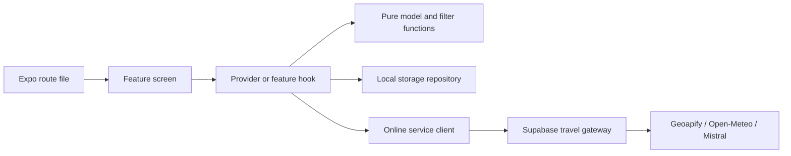

# MAPPER: file-by-file study guide

Use this guide to understand the existing project before writing more code. Application development is paused. This is a documentation-only addition; no application logic, credentials, migrations or deployments are changed by preparing this guide.

## Repository verification

Checked on **5 November 2026**:

- Repository: [Avinaash076/MAPPER](https://github.com/Avinaash076/MAPPER), publicly accessible.
- Local working source: `feature/woven-theme`, commit `32b4ad80e1f53b5289538a790c8b1670f29cdbd3`.
- GitHub's feature branch matched that local commit at the time of the source audit.
- GitHub `main`: `e6ba38b62c8a4bb54e7a01509764b114899b6a0c`. It contains the feature work and has seven additional history entries. The current file difference from this local source is one label in `src/app/setup.tsx`; function names and the study structure are the same.
- The latest main-branch **App checks** run completed successfully: [verified GitHub Actions run](https://github.com/Avinaash076/MAPPER/actions/runs/41988038007). The workflow runs TypeScript, lint, tests, formatting, dependency compatibility and Android/web exports.
- A successful source check/export does not establish hosted Supabase setup, Mistral account quota, native-device behavior or a Play Store release. No hosted service was deployed during this audit.
- The current private `.env`/`.env.local` paths checked are not tracked by Git. Their values are not included here.

The source audit is based on the local commit above. A later documentation-only commit adds this guide. GitHub line links below use the branch where you open the guide; source changes in a future commit can move line numbers. Use Ctrl+F with the named function if a line moves; for a dotted nested name, search the part after the final dot. Older review documents describe their dated milestone; use the audited source and current service/setup guides to distinguish implemented code from deployed services.

## Read in this order

| Reading session                      | Files to read                                                                                                                                                                                                                                                                                                                                                      | Question to answer without editing code                                                       |
| ------------------------------------ | ------------------------------------------------------------------------------------------------------------------------------------------------------------------------------------------------------------------------------------------------------------------------------------------------------------------------------------------------------------------ | --------------------------------------------------------------------------------------------- |
| 1. Understand the app                | [README](../README.md), [package.json](../package.json), [app.json](../app.json), [architecture](architecture.md)                                                                                                                                                                                                                                                  | Which command opens the app, and which settings define its identity?                          |
| 2. Understand a place                | [types.ts](../src/features/places/types.ts), [seedPlaces.ts](../src/features/places/seedPlaces.ts), [data.ts](../src/features/places/data.ts), [repository.ts](../src/features/places/repository.ts)                                                                                                                                                               | How does one stable place ID connect its text, coordinates, categories and photo?             |
| 3. Follow navigation                 | [root layout](../src/app/_layout.tsx), [welcome route](../src/app/index.tsx), [WelcomeScreen](../src/features/welcome/WelcomeScreen.tsx), [DestinationScreen](../src/features/journey/DestinationScreen.tsx)                                                                                                                                                       | What happens when the user chooses a known destination?                                       |
| 4. Follow local state                | [app model](../src/features/state/model.ts), [AppProvider](../src/features/state/AppProvider.tsx), [app persistence](../src/features/state/persistence.ts), [journey model](../src/features/journey/model.ts), [JourneyProvider](../src/features/journey/JourneyProvider.tsx)                                                                                      | What is saved, where is it restored, and what happens if saved JSON is invalid?               |
| 5. Understand discovery and planning | [filterPlaces](../src/features/places/discovery.ts), [travel calculations](../src/features/planning/travel.ts), [route calculations](../src/features/journey/routeModel.ts), [TripDetails](../src/features/journey/TripDetails.tsx), [core tests](../tests/core.test.ts), [journey tests](../tests/journey.test.ts)                                                | Which estimates are illustrative, and which results require a road-routing provider?          |
| 6. Understand the UI system          | [tokens](../src/theme/tokens.ts), [palettes](../src/theme/palettes.ts), [ThemeProvider](../src/theme/ThemeProvider.tsx), [shared UI](../src/components/ui/index.ts), [PlaceCard](../src/components/PlaceCard.tsx), [icons](../src/components/icons.ts)                                                                                                             | Which shared file would control spacing, colours or a button across screens?                  |
| 7. Understand maps                   | [map types](../src/features/map/types.ts), [map model](../src/features/map/model.ts), [web adapter](../src/features/map/PlaceMap.web.tsx), [native adapter](../src/features/map/PlaceMap.native.tsx), [useOnlineTrip](../src/features/journey/useOnlineTrip.ts)                                                                                                    | How does returned route geometry become a visible line?                                       |
| 8. Understand hidden places          | [hidden-place guide](hidden-places.md), [draft types](../src/features/contributions/types.ts), [draft model](../src/features/contributions/model.ts), [draft repository](../src/features/contributions/repository.ts), [useDraftEditor](../src/features/contributions/useDraftEditor.ts), [submission service](../src/features/contributions/submissionService.ts) | Why does saving a local draft not publish it?                                                 |
| 9. Understand online services        | [public client](../src/services/communityClient.ts), [travel client](../src/services/travel/client.ts), [gateway](../supabase/functions/_shared/gateway.ts), [providers](../supabase/functions/_shared/providers.ts), [Mistral adapter](../supabase/functions/_shared/assistant.ts), [SQL migrations](../supabase/migrations/)                                     | Which process holds the private keys, verifies a user and applies quotas?                     |
| 10. Understand testing/tooling       | [tests](../tests/), [backend scripts](../scripts/backend/), [Metro configuration](../metro.config.js), [CI workflow](../.github/workflows/checks.yml)                                                                                                                                                                                                              | Which commands use mocks, which make network requests, and which can change hosted resources? |
| 11. Review alternative designs last  | [gallery README](../design-exploration/README.md), [designs.ts](../design-exploration/src/designs.ts), [ScreenStudies](../design-exploration/src/stage4/ScreenStudies.tsx)                                                                                                                                                                                         | How is the browser comparison gallery different from the production app?                      |

Start with sessions 1–3. Then trace one button end-to-end before reading every feature. The complete inventory later in this document is a reference, not a requirement to memorize all filenames at once.

## What the filenames mean

| Name/pattern                       | Meaning in this repository                                                                                                     |
| ---------------------------------- | ------------------------------------------------------------------------------------------------------------------------------ |
| `.tsx`                             | TypeScript that can render React/React Native JSX. A function such as `PlaceCard` is a component.                              |
| `.ts`                              | Types, state, pure logic, services or hooks. It is not necessarily UI.                                                         |
| `src/app/`                         | Expo Router entry files. Many simply re-export a feature screen.                                                               |
| `_layout.tsx`                      | Navigation/provider composition for a route group.                                                                             |
| `(tabs)`                           | Route grouping for Discover/My plan/Saved. Parentheses are folder syntax, not a screen title.                                  |
| `[id].tsx`                         | Dynamic place route: the same screen receives different place IDs.                                                             |
| `model.ts`                         | Data shapes and/or pure feature rules. Read these before the screen that uses them.                                            |
| `Provider.tsx` / `useSomething`    | Shared React state or a hook that coordinates state/lifecycles.                                                                |
| `persistence.ts` / `repository.ts` | Boundaries for validated saved records and data access.                                                                        |
| `.web.tsx` / `.native.tsx`         | Platform-specific implementation selected by the bundler. Read both, but understand that both are not rendered simultaneously. |
| `.d.ts`                            | Type declarations only; functions declared there are signatures, not runtime implementations.                                  |
| `scripts/`                         | Developer commands executed from Node/PowerShell, outside the app UI.                                                          |
| `supabase/functions/`              | Backend code executed by Deno/Supabase. Private provider credentials are read here.                                            |
| `supabase/migrations/`             | Versioned SQL for tables, privileges, RLS, triggers and database functions.                                                    |
| `design-exploration/`              | Separate browser design studies with their own controls/data/build. These are not additional installed native apps.            |

## The main system flow

The online branch is used when the user asks for an online action. Local browsing/plans/drafts have their own data/storage path. The map basemap is a separate OpenFreeMap/MapLibre path and does not prove the travel gateway is deployed.

### Trace a bookmark

`PlaceCard` or place details → `dispatch({ type: 'toggleSaved', id })` → `appReducer` updates `savedIds` → `AppProvider` queues persistence → Saved tab reads the same IDs against the catalog. A bookmark stores an ID, not a second copy of the place.

### Trace a destination journey

`WelcomeScreen` → `/destination` → `DestinationScreen`/`PointSearch` → `JourneyProvider.chooseDestination` → `/starting-point` → `/trip-experience` → `/trip-options` → `showPlan` → `/trip-map` → `TripMapScreen`/`TripDetails`.

### Trace a real route

Choose transport and open Trip details → `OnlineTripServices` calls `useOnlineTrip.refresh` → `requestTravel('route', ...)` → `travel-services` → `createTravelHandler` verifies the account and quota → `getRoute` calls Geoapify → checked geometry/legs return to the hook → `TripMapScreen` passes geometry to `PlaceMap` → a route line is drawn.

A source implementation of this flow is not the same as an already configured/deployed service. Read [Supabase setup](supabase-setup.md) for activation; it is optional while studying the local UI.

### Trace a hidden place

Contributions list → new `PlaceDraft` → `useDraftEditor` → local metadata repository and platform photo storage → explicit user submission → `submitDraft` uploads owner-only metadata/photos and transitions to pending → administrator review chooses public coordinates → approved row in `community_places` → public catalog refresh.

Saving privately, sending for review, administrator approval and verifying current conditions are different stages. Approval is never performed by AI. A reviewed record does not guarantee current access or weather safety.

### Trace an AI question

`AssistantScreen` → Examples mode calls `getExampleAnswer` locally; Ask AI mode calls `requestTravel('assistant', ...)` → authenticated backend selects public records → `askMistral` → output/source-ID checks → `AssistantMessage` renders text and canonical background links. The UI conversation is displayed locally, but each live question is currently sent independently; prior conversation turns, private drafts and captured location are not automatically forwarded.

## Important functions in plain words

| Function                                              | What to understand                                                                                                        |
| ----------------------------------------------------- | ------------------------------------------------------------------------------------------------------------------------- |
| `placeRepository.list` / `get`                        | Read the bundled catalog or one stable place ID.                                                                          |
| `filterPlaces`                                        | Combine search, interests, radius and optional travel/time filtering; return a new ordered list.                          |
| `distanceKm`                                          | Convert two latitude/longitude points into Haversine distance. Its local `rad` helper converts degrees to radians.        |
| `estimateTravelMinutes`                               | Use distance, a rough detour allowance and an assumed speed; this is not road routing.                                    |
| `summarizePlan`                                       | Add outward legs, visits and the return to town; compare with the local day-plan budget.                                  |
| `formatMinutes`                                       | Convert minute counts into readable hours/minutes.                                                                        |
| `appReducer`                                          | Apply one action to app state without making a network/storage request itself.                                            |
| `decodeState` / `readFilters` / `knownUniqueIds`      | Validate/migrate stored app JSON and preserve valid, unique IDs.                                                          |
| `createStateWriter`                                   | Queue writes so a slow older snapshot does not overwrite a newer one.                                                     |
| `AppProvider.hydrate`                                 | Restore saved app data before allowing normal persistence.                                                                |
| `townPoints` / `placePoint`                           | Turn the known town/place data into destination/start choices.                                                            |
| `searchDestinations`                                  | Search local town/place names; it is independent of online geocoding.                                                     |
| `rememberDestination`                                 | Keep a small deduplicated recent-choice list.                                                                             |
| `destinationSuggestions`                              | Filter public catalog places around the selected destination radius/interests.                                            |
| `validClock` / `validTravelDate`                      | Reject malformed departure/date input before saving/navigation.                                                           |
| `arrivalLabel`                                        | Format an offset from departure, including next-day labels.                                                               |
| `estimateJourney`                                     | Build the destination journey's illustrative ordered one-way itinerary.                                                   |
| `decodeJourney` / `createJourneyWriter`               | Validate/queue the journey record separately from My plan.                                                                |
| `JourneyProvider.chooseDestination`                   | Preserve compatible selections when the target is unchanged; reset incompatible journey choices when it changes.          |
| `JourneyProvider.toggleStop`                          | Add/remove a chosen catalog stop without duplicates.                                                                      |
| `tripRequestKey` / `useOnlineTrip.refresh`            | Tie returned route/forecast data to the right account/points/date/mode and request new data explicitly.                   |
| `segmentDistanceKm` / `routeDistanceKm`               | Estimate geographic distance from a place to route segments. This is not detour driving time.                             |
| `journeySuggestions`                                  | Merge route-corridor and destination suggestions according to the selected experience.                                    |
| `roadArrivals`                                        | Accumulate actual route-leg durations and suggested visit durations into arrival offsets.                                 |
| `getMapStyle`                                         | Resolve Liberty/Dark map style independently from the app appearance setting.                                             |
| `placesToGeoJson` / `routeFeature`                    | Turn app data into map marker/line source data.                                                                           |
| `pointBounds` / `routeExtentPoints`                   | Frame endpoints/places/route extents without inventing a route.                                                           |
| `mapFailureMessage`                                   | Present helpful map failures without echoing raw URLs/secrets.                                                            |
| `decodeThemePreference` / `resolveColorScheme`        | Restore a valid preference and combine System with device appearance.                                                     |
| `createEmptyDraft`                                    | Make an incomplete private draft the user can finish later.                                                               |
| `validCoordinates` / `submissionProblems`             | Check valid coordinates and the stricter information/consents required to send for review.                                |
| `nearbyDuplicates`                                    | Suggest nearby catalog records for manual duplicate review.                                                               |
| `decodeDrafts` / `createDraftRepository`              | Validate and serialize private local draft metadata operations.                                                           |
| `useDraftEditor.change`                               | Save the newest metadata revision and clean up removed photo assets after saving.                                         |
| `requestLocation`                                     | Check permission and location services, then use a bounded foreground request with a manual fallback.                     |
| `captureCurrentLocation` / `pickDraftPhotos`          | Use Expo device APIs only after an explicit user action.                                                                  |
| `savePhoto` / `readPhotoBytes` / `removePhoto`        | Platform-specific app-owned photo storage; web/native files implement the same responsibility.                            |
| `buildSubmissionFields`                               | Build owner-safe server metadata and deterministic photo paths from the draft.                                            |
| `submitDraft`                                         | Authenticate, create/update the private server draft, upload photos and request review. It does not approve publication.  |
| `SignInPanel.sendCode` / `verify`                     | Request an email OTP and verify it; this is different from owner CLI login.                                               |
| `loadCommunityPlaces`                                 | Read approved rows and signed photo URLs; merge into the catalog through the provider.                                    |
| `serviceErrorMessage` / `requestTravel`               | Enforce the online flag/session, call the gateway and translate safe error codes.                                         |
| `userId` / `consumeQuota`                             | Verify a confirmed account and apply persistent database request limits before provider calls.                            |
| `publicPlaces` / `publicContext`                      | Build server-owned public AI context; ignore caller-supplied private catalog descriptions.                                |
| `createTravelHandler`                                 | Validate CORS/method/body, authenticate, apply quotas, dispatch one action and sanitize failures.                         |
| `searchAddresses`                                     | Geoapify India-filtered address autocomplete; not AI ranking.                                                             |
| `parseRoute` / `getRoute`                             | Validate/call Geoapify for actual ordered geometry, metric distance and route-leg durations.                              |
| `getWeather`                                          | Read a destination daily forecast in Asia/Kolkata, for today or the next six days.                                        |
| `askMistral`                                          | Send public evidence, require structured output and accept only known source IDs. Factual accuracy still requires review. |
| `readJson` / `fetchJson`                              | Bound response size/time and keep upstream errors out of user-facing output.                                              |
| `requestData`                                         | Parse only the supported typed action fields and reject invalid shapes/ranges.                                            |
| `check_place_submission` / `approve_place_submission` | SQL validation/review rules; approval requires privileged administrator access and explicit public coordinates.           |
| `consume_travel_quota`                                | SQL atomic per-day counter updates, locked consistently to prevent cross-instance races.                                  |
| `prepareBackendFiles` / `readBackendConfig`           | Developer-only env preparation/reading; preserve existing keys and keep secrets out of output.                            |
| `checkRemoteBackend`                                  | Safe connection checks without sending email or invoking paid provider actions.                                           |
| `checkProviderKeys`                                   | Direct Node provider checks, bypassing the app gateway; `--chat` explicitly generates a sample answer.                    |

## Two planners that must not be confused

| Flow                | State                                                          | Time calculation                                                                          | Ends where?                                               |
| ------------------- | -------------------------------------------------------------- | ----------------------------------------------------------------------------------------- | --------------------------------------------------------- |
| My plan tab         | `AppState.planIds`, app filters                                | `summarizePlan` with illustrative speeds/visits                                           | Returns to the selected town centre                       |
| Destination journey | `JourneyState` start/destination/stop IDs and journey settings | `estimateJourney` fallback; optional online route legs via `useOnlineTrip`/`roadArrivals` | Ends at the selected destination; no automatic return leg |

Copying destination-trip places into My plan appends eligible catalog IDs without replacing that plan's settings/order. Neither flow currently implements downloaded routing graphs or offline rerouting.

## Where current feature boundaries are visible in code

- `src/services/travel/client.ts`: online services require the public enable flag and a configured Supabase client; sending requires a user session.
- `supabase/functions/travel-services/index.ts`: server reads provider keys/model/weather settings; putting keys in a local file alone does not deploy this function.
- `OnlineTripServices`: explicit Check route and weather action, unconfigured/sign-in/busy/error states and independent results.
- `SurpriseScreen`: catalog filtering only; AI ranking is intentionally not connected there.
- `AssistantScreen`: local examples and live questions are separate modes; an upstream failure does not silently become a sample answer.
- `PlaceMap.web.tsx` / `.native.tsx`: the map can render tiles/pins even when there is no returned road geometry.
- Mistral HTTP 429 is an upstream account/model rate or quota response, separate from whether the backend code compiles or Geoapify works.
- Community publication requires administrator review. Private capture coordinates and reviewer-chosen public coordinates are different data.

## Files and commands to leave until later

`node_modules/` is installed library code; `dist/` is generated export output; `.expo/` and `.metro-cache/` are generated development state; `.tools/` contains ignored temporary verification artefacts; `.git/` stores repository history. Read the project's source first rather than these generated folders. `public/maplibre-worker.mjs` is generated by `scripts/prepare-map.mjs` and is not a source file to edit.

Private configuration files are intentionally outside the GitHub inventory:

| Local path                                | Purpose                                                                                                     |
| ----------------------------------------- | ----------------------------------------------------------------------------------------------------------- |
| Root `.env.local`                         | Public Supabase URL, public publishable key and online-feature flag.                                        |
| `supabase/functions/.env` or `.env.local` | Private provider settings for developer checks/server secret upload. Never move these into `EXPO_PUBLIC_*`. |
| `supabase/.temp/`                         | Local CLI linking/cache state; ignored by Git.                                                              |

While studying, simply opening files has no effect on services. `npm test` uses the repository's automated tests/fixtures. `keys:check` makes real provider calls; `backend:test` sends an OTP and optionally makes provider calls; migration/secret/deploy commands can change hosted resources. You do not need to run those network/deployment commands just to understand the source.

For every file, ask: What data comes in? What is returned/rendered? Does it change local state? Does it read/write storage or the network? Which test describes the expected behavior? These questions make the large inventory manageable.

## Complete file and function index

The inventory below covers all **288 files tracked at source commit 32b4ad8**, including **188 JavaScript/TypeScript source/declaration files**. Private env files, dependencies and generated output are outside this inventory. This new guide is an additional documentation file.

Function links jump to their definition line on GitHub. A dotted name identifies a nested helper or object callback, for example `SignInPanel.sendCode`. Identical callback names can appear at different lines. Type declarations are signatures, not executable bodies. Anonymous JSX/onPress/map callbacks remain in their parent source and are not given invented function names. Data-only files list exported records/types instead.

### 1. Project configuration and CI

| File                                                            | Responsibility                                                                                                                    | Named functions / important exports                          |
| --------------------------------------------------------------- | --------------------------------------------------------------------------------------------------------------------------------- | ------------------------------------------------------------ |
| [.editorconfig](../.editorconfig)                               | Editor whitespace and indentation conventions.                                                                                    | No executable functions.                                     |
| [.env.example](../.env.example)                                 | Public client setting names only. Real values belong in ignored root .env.local.                                                  | No executable functions.                                     |
| [.gitattributes](../.gitattributes)                             | Git text/line-ending handling.                                                                                                    | No executable functions.                                     |
| [.github/workflows/checks.yml](../.github/workflows/checks.yml) | GitHub Actions: install, typecheck/lint/tests/format, dependency compatibility and Android/web exports. Does not deploy services. | No executable functions.                                     |
| [.gitignore](../.gitignore)                                     | Keeps dependency folders, builds, caches, local CLI state and private env files out of Git.                                       | No executable functions.                                     |
| [.npmrc](../.npmrc)                                             | Repository npm installation options.                                                                                              | No executable functions.                                     |
| [.prettierignore](../.prettierignore)                           | Files/folders excluded from automatic formatting.                                                                                 | No executable functions.                                     |
| [.prettierrc.json](../.prettierrc.json)                         | Shared formatting choices.                                                                                                        | No executable functions.                                     |
| [AGENTS.md](../AGENTS.md)                                       | Repository working rules, validation expectations, privacy and offline boundaries.                                                | No executable functions.                                     |
| [README.md](../README.md)                                       | Project introduction, run commands and links to the detailed guides.                                                              | No executable functions.                                     |
| [app.json](../app.json)                                         | Expo app identity, platform settings, plugins and permission wording.                                                             | No executable functions.                                     |
| [eas.json](../eas.json)                                         | EAS development, preview APK and production build profiles.                                                                       | No executable functions.                                     |
| [eslint.config.js](../eslint.config.js)                         | Lint rules, including safe JSX children and preventing full Phosphor catalog imports.                                             | Top-level script or anonymous callbacks; read the file body. |
| [metro.config.js](../metro.config.js)                           | Expo Metro configuration, Windows worker limit, cache isolation and excluded folders.                                             | [escapePattern](../metro.config.js#L37)                      |
| [netlify.toml](../netlify.toml)                                 | Static web build/output settings and community-place route fallback.                                                              | No executable functions.                                     |
| [package-lock.json](../package-lock.json)                       | Exact installed dependency versions; generated by npm and used by npm ci.                                                         | No executable functions.                                     |
| [package.json](../package.json)                                 | App dependencies and executable npm scripts. Start here to understand run/check/build commands.                                   | No executable functions.                                     |
| [tsconfig.json](../tsconfig.json)                               | TypeScript strictness, source paths and .ts import compatibility with Deno.                                                       | No executable functions.                                     |

### 2. Existing documentation

| File                                                                            | Responsibility                                                                                                                       | Named functions / important exports |
| ------------------------------------------------------------------------------- | ------------------------------------------------------------------------------------------------------------------------------------ | ----------------------------------- |
| [docs/README.md](../docs/README.md)                                             | Documentation: Project documentation. Read as a dated guide/review, not proof of hosted deployment.                                  | No executable functions.            |
| [docs/architecture.md](../docs/architecture.md)                                 | Documentation: How the system works. Read as a dated guide/review, not proof of hosted deployment.                                   | No executable functions.            |
| [docs/deployment.md](../docs/deployment.md)                                     | Documentation: Publish to Google Play or the web. Read as a dated guide/review, not proof of hosted deployment.                      | No executable functions.            |
| [docs/design-and-credits.md](../docs/design-and-credits.md)                     | Documentation: Design direction and content credits. Read as a dated guide/review, not proof of hosted deployment.                   | No executable functions.            |
| [docs/design-exploration-stage-3.md](../docs/design-exploration-stage-3.md)     | Documentation: Stage 3 design exploration review. Read as a dated guide/review, not proof of hosted deployment.                      | No executable functions.            |
| [docs/destination-discovery-review.md](../docs/destination-discovery-review.md) | Documentation: Destination discovery redesign and API audit. Read as a dated guide/review, not proof of hosted deployment.           | No executable functions.            |
| [docs/development.md](../docs/development.md)                                   | Documentation: Development and guided exercises. Read as a dated guide/review, not proof of hosted deployment.                       | No executable functions.            |
| [docs/discovery-lens.md](../docs/discovery-lens.md)                             | Documentation: Discovery Lens — UI implementation and next steps. Read as a dated guide/review, not proof of hosted deployment.      | No executable functions.            |
| [docs/hidden-places.md](../docs/hidden-places.md)                               | Documentation: Hidden places: drafts, photos and reviewed publication. Read as a dated guide/review, not proof of hosted deployment. | No executable functions.            |
| [docs/metro-troubleshooting.md](../docs/metro-troubleshooting.md)               | Documentation: Metro on Windows: open-file and cache recovery. Read as a dated guide/review, not proof of hosted deployment.         | No executable functions.            |
| [docs/offline-routing.md](../docs/offline-routing.md)                           | Documentation: Offline maps and downloadable routes. Read as a dated guide/review, not proof of hosted deployment.                   | No executable functions.            |
| [docs/rendering-and-map-recovery.md](../docs/rendering-and-map-recovery.md)     | Documentation: Empty text nodes, map loading and API keys. Read as a dated guide/review, not proof of hosted deployment.             | No executable functions.            |
| [docs/review.md](../docs/review.md)                                             | Documentation: Woven design and hidden-place contribution review. Read as a dated guide/review, not proof of hosted deployment.      | No executable functions.            |
| [docs/running.md](../docs/running.md)                                           | Documentation: Run MAPPER on PC and Android. Read as a dated guide/review, not proof of hosted deployment.                           | No executable functions.            |
| [docs/supabase-setup.md](../docs/supabase-setup.md)                             | Documentation: Set up and test Supabase from Windows. Read as a dated guide/review, not proof of hosted deployment.                  | No executable functions.            |
| [docs/travel-services.md](../docs/travel-services.md)                           | Documentation: Routing, forecasts and Mistral AI. Read as a dated guide/review, not proof of hosted deployment.                      | No executable functions.            |
| [docs/ui-polish-review.md](../docs/ui-polish-review.md)                         | Documentation: Discovery Lens: usability polish. Read as a dated guide/review, not proof of hosted deployment.                       | No executable functions.            |
| [docs/ui-validation.md](../docs/ui-validation.md)                               | Documentation: Discovery Lens validation record. Read as a dated guide/review, not proof of hosted deployment.                       | No executable functions.            |
| [docs/woven-theme.md](../docs/woven-theme.md)                                   | Documentation: Woven design and appearance. Read as a dated guide/review, not proof of hosted deployment.                            | No executable functions.            |

### 3. Route files: src/app

| File                                                            | Responsibility                                                                                                             | Named functions / important exports                                                                                                                                                                                                                                |
| --------------------------------------------------------------- | -------------------------------------------------------------------------------------------------------------------------- | ------------------------------------------------------------------------------------------------------------------------------------------------------------------------------------------------------------------------------------------------------------------ |
| [src/app/(tabs)/\_layout.tsx](<../src/app/(tabs)/_layout.tsx>)  | Discover/My plan/Saved tab labels, selected icons and theme-aware navigation.                                              | [TabLayout](<../src/app/(tabs)/_layout.tsx#L7>); [TabLayout.tabBarIcon](<../src/app/(tabs)/_layout.tsx#L33>); [TabLayout.tabBarIcon](<../src/app/(tabs)/_layout.tsx#L42>); [TabLayout.tabBarIcon](<../src/app/(tabs)/_layout.tsx#L51>)                             |
| [src/app/(tabs)/discover.tsx](<../src/app/(tabs)/discover.tsx>) | Thin tab route that re-exports DiscoverScreen.                                                                             | Re-exports existing symbols; no local function definitions.                                                                                                                                                                                                        |
| [src/app/(tabs)/plan.tsx](<../src/app/(tabs)/plan.tsx>)         | Local town-centre day-plan screen; ordering, removal/undo and time summary.                                                | [PlanScreen](<../src/app/(tabs)/plan.tsx#L16>)                                                                                                                                                                                                                     |
| [src/app/(tabs)/saved.tsx](<../src/app/(tabs)/saved.tsx>)       | Bookmarked places and its actionable empty state.                                                                          | [SavedScreen](<../src/app/(tabs)/saved.tsx#L11>)                                                                                                                                                                                                                   |
| [src/app/+not-found.tsx](../src/app/+not-found.tsx)             | Fallback screen for unknown routes with a way back to discovery.                                                           | [NotFound](../src/app/+not-found.tsx#L3)                                                                                                                                                                                                                           |
| [src/app/\_layout.tsx](../src/app/_layout.tsx)                  | Starts fonts, safe areas, theme/catalog/app/journey/map providers, stack navigation and loading state.                     | [AppNavigation](../src/app/_layout.tsx#L21); [header.headerRight](../src/app/_layout.tsx#L40); [RootLayout](../src/app/_layout.tsx#L69)                                                                                                                            |
| [src/app/assistant.tsx](../src/app/assistant.tsx)               | Thin route for the example/live AI assistant.                                                                              | Re-exports existing symbols; no local function definitions.                                                                                                                                                                                                        |
| [src/app/contribute.tsx](../src/app/contribute.tsx)             | Thin route for editing a private hidden-place draft.                                                                       | Re-exports existing symbols; no local function definitions.                                                                                                                                                                                                        |
| [src/app/contributions.tsx](../src/app/contributions.tsx)       | Lists local drafts/review states, creates a draft and refreshes review status.                                             | [ContributionsScreen](../src/app/contributions.tsx#L12); [ContributionsScreen.load](../src/app/contributions.tsx#L16); [ContributionsScreen.createDraft](../src/app/contributions.tsx#L31); [ContributionsScreen.refreshReviews](../src/app/contributions.tsx#L43) |
| [src/app/destination.tsx](../src/app/destination.tsx)           | Thin route for choosing a destination; implementation is in features/journey.                                              | Re-exports existing symbols; no local function definitions.                                                                                                                                                                                                        |
| [src/app/index.tsx](../src/app/index.tsx)                       | Thin welcome route: re-exports WelcomeScreen as the default screen.                                                        | Re-exports existing symbols; no local function definitions.                                                                                                                                                                                                        |
| [src/app/place/[id].tsx](../src/app/place/[id].tsx)             | Place details, sources, photo credits, save/plan actions and static paths for bundled web destinations.                    | [generateStaticParams](../src/app/place/[id].tsx#L15); [PlaceScreen](../src/app/place/[id].tsx#L18); [PlaceScreen.openSource](../src/app/place/[id].tsx#L25)                                                                                                       |
| [src/app/setup.tsx](../src/app/setup.tsx)                       | Existing three-step town/interests/transport setup and Android Back behavior; separate from the newer destination journey. | [SetupScreen](../src/app/setup.tsx#L30); [SetupScreen.finish](../src/app/setup.tsx#L46); [SetupScreen.skip](../src/app/setup.tsx#L50)                                                                                                                              |
| [src/app/starting-point.tsx](../src/app/starting-point.tsx)     | Thin route for selecting or capturing the trip start.                                                                      | Re-exports existing symbols; no local function definitions.                                                                                                                                                                                                        |
| [src/app/surprise.tsx](../src/app/surprise.tsx)                 | Thin route for nearby discovery from interests and an area.                                                                | Re-exports existing symbols; no local function definitions.                                                                                                                                                                                                        |
| [src/app/trip-experience.tsx](../src/app/trip-experience.tsx)   | Thin route for direct, along-route, destination or combined exploration.                                                   | Re-exports existing symbols; no local function definitions.                                                                                                                                                                                                        |
| [src/app/trip-map.tsx](../src/app/trip-map.tsx)                 | Thin route for the destination trip map and details/suggestions sheets.                                                    | Re-exports existing symbols; no local function definitions.                                                                                                                                                                                                        |
| [src/app/trip-options.tsx](../src/app/trip-options.tsx)         | Thin route for transport, radii, departure/date and budget preferences.                                                    | Re-exports existing symbols; no local function definitions.                                                                                                                                                                                                        |

### 4. Shared components: src/components

| File                                                                          | Responsibility                                                                                                                | Named functions / important exports                                                                                                                       |
| ----------------------------------------------------------------------------- | ----------------------------------------------------------------------------------------------------------------------------- | --------------------------------------------------------------------------------------------------------------------------------------------------------- |
| [src/components/AppHeader.tsx](../src/components/AppHeader.tsx)               | Shared app heading and appearance action.                                                                                     | [AppHeader](../src/components/AppHeader.tsx#L7)                                                                                                           |
| [src/components/AppearancePicker.tsx](../src/components/AppearancePicker.tsx) | System/Light/Dark appearance selection.                                                                                       | [AppearancePicker](../src/components/AppearancePicker.tsx#L23)                                                                                            |
| [src/components/BrandMark.tsx](../src/components/BrandMark.tsx)               | Original M trail SVG mark, with platform-appropriate accessibility props.                                                     | [BrandMark](../src/components/BrandMark.tsx#L5)                                                                                                           |
| [src/components/FilterSheet.tsx](../src/components/FilterSheet.tsx)           | Editable discovery-filter draft with matching-count preview, apply and reset behavior.                                        | [FilterSheet](../src/components/FilterSheet.tsx#L18)                                                                                                      |
| [src/components/PlaceCard.tsx](../src/components/PlaceCard.tsx)               | Destination photograph/fallback, concise facts, credits context, save control and detail navigation.                          | [PlacePhoto](../src/components/PlaceCard.tsx#L17); [PlaceCard](../src/components/PlaceCard.tsx#L56); [createStyles](../src/components/PlaceCard.tsx#L120) |
| [src/components/ProviderCredits.tsx](../src/components/ProviderCredits.tsx)   | Accessible external attribution links for Geoapify/OpenStreetMap and Open-Meteo.                                              | [ProviderCredits](../src/components/ProviderCredits.tsx#L7)                                                                                               |
| [src/components/WovenArtwork.tsx](../src/components/WovenArtwork.tsx)         | Bundled decorative landscape artwork for welcome/setup composition.                                                           | [WovenArtwork](../src/components/WovenArtwork.tsx#L4)                                                                                                     |
| [src/components/icons.ts](../src/components/icons.ts)                         | Re-exports only 19 used icons through supported individual Phosphor entry points, reducing Metro work.                        | Re-exports existing symbols; no local function definitions.                                                                                               |
| [src/components/ui/CheckRow.tsx](../src/components/ui/CheckRow.tsx)           | Labelled selectable row with a visible checked state.                                                                         | [CheckRow](../src/components/ui/CheckRow.tsx#L7)                                                                                                          |
| [src/components/ui/Disclosure.tsx](../src/components/ui/Disclosure.tsx)       | Expandable secondary content with an accessible heading/action.                                                               | [Disclosure](../src/components/ui/Disclosure.tsx#L9)                                                                                                      |
| [src/components/ui/EmptyState.tsx](../src/components/ui/EmptyState.tsx)       | Consistent empty-state title, description and next action.                                                                    | [EmptyState](../src/components/ui/EmptyState.tsx#L11)                                                                                                     |
| [src/components/ui/Field.tsx](../src/components/ui/Field.tsx)                 | Shared theme-aware text input.                                                                                                | [Field](../src/components/ui/Field.tsx#L7)                                                                                                                |
| [src/components/ui/Label.tsx](../src/components/ui/Label.tsx)                 | Shared Text component with semantic colour and typography variants; raw strings inside native Views must use text components. | [Label](../src/components/ui/Label.tsx#L7)                                                                                                                |
| [src/components/ui/Notice.tsx](../src/components/ui/Notice.tsx)               | Inline informational/warning message with a consistent icon and surface.                                                      | [Notice](../src/components/ui/Notice.tsx#L9)                                                                                                              |
| [src/components/ui/Panel.tsx](../src/components/ui/Panel.tsx)                 | Shared bordered/rounded content surface.                                                                                      | [Panel](../src/components/ui/Panel.tsx#L5)                                                                                                                |
| [src/components/ui/Screen.tsx](../src/components/ui/Screen.tsx)               | Safe-area scroll container, keyboard behavior and storage feedback.                                                           | [Screen](../src/components/ui/Screen.tsx#L8)                                                                                                              |
| [src/components/ui/Sheet.tsx](../src/components/ui/Sheet.tsx)                 | Dismissible accessible sheet, close action and scrollable content.                                                            | [Sheet](../src/components/ui/Sheet.tsx#L17)                                                                                                               |
| [src/components/ui/buttons.tsx](../src/components/ui/buttons.tsx)             | Shared Button, IconButton and selectable Chip with touch/focus/disabled states.                                               | [Button](../src/components/ui/buttons.tsx#L10); [IconButton](../src/components/ui/buttons.tsx#L59); [Chip](../src/components/ui/buttons.tsx#L87)          |
| [src/components/ui/index.ts](../src/components/ui/index.ts)                   | Convenience re-exports for shared UI primitives; it contains no screen-specific business rules.                               | Re-exports existing symbols; no local function definitions.                                                                                               |
| [src/components/ui/layout.ts](../src/components/ui/layout.ts)                 | Reusable row, wrapping, spacing and alignment style objects.                                                                  | Data/types: `layout`                                                                                                                                      |
| [src/components/ui/styles.ts](../src/components/ui/styles.ts)                 | Theme-aware styles for the shared UI primitives.                                                                              | [createStyles](../src/components/ui/styles.ts#L5); [useUIStyles](../src/components/ui/styles.ts#L88)                                                      |

### 5. Theme: src/theme

| File                                                              | Responsibility                                                                                                    | Named functions / important exports                                                                                                                                  |
| ----------------------------------------------------------------- | ----------------------------------------------------------------------------------------------------------------- | -------------------------------------------------------------------------------------------------------------------------------------------------------------------- |
| [src/theme/ThemeProvider.tsx](../src/theme/ThemeProvider.tsx)     | Restores appearance, follows device appearance, exposes colours and saves user changes separately from trip data. | [ThemeProvider](../src/theme/ThemeProvider.tsx#L32); [ThemeProvider.chooseTheme](../src/theme/ThemeProvider.tsx#L67); [useTheme](../src/theme/ThemeProvider.tsx#L84) |
| [src/theme/palettes.ts](../src/theme/palettes.ts)                 | Semantic light/dark colour values and ThemeColors type.                                                           | Data/types: `lightColors`, `ThemeColors`, `darkColors`                                                                                                               |
| [src/theme/preferences.ts](../src/theme/preferences.ts)           | Validates appearance preference, resolves system/light/dark and queues appearance writes.                         | [decodeThemePreference](../src/theme/preferences.ts#L6); [resolveColorScheme](../src/theme/preferences.ts#L12); [createThemeWriter](../src/theme/preferences.ts#L19) |
| [src/theme/tokens.ts](../src/theme/tokens.ts)                     | Shared spacing scale, Manrope face names and corner radii.                                                        | Data/types: `space`, `fonts`, `radii`                                                                                                                                |
| [src/theme/useReducedMotion.ts](../src/theme/useReducedMotion.ts) | Observes the accessibility reduced-motion preference.                                                             | [useReducedMotion](../src/theme/useReducedMotion.ts#L4)                                                                                                              |
| [src/theme/useThemedStyles.ts](../src/theme/useThemedStyles.ts)   | Memoizes a style factory against the resolved theme.                                                              | [useThemedStyles](../src/theme/useThemedStyles.ts#L5)                                                                                                                |

### 6. Place discovery and catalog

| File                                                                                            | Responsibility                                                                                               | Named functions / important exports                                                                                                                                                                                                      |
| ----------------------------------------------------------------------------------------------- | ------------------------------------------------------------------------------------------------------------ | ---------------------------------------------------------------------------------------------------------------------------------------------------------------------------------------------------------------------------------------- |
| [src/features/places/DiscoverScreen.tsx](../src/features/places/DiscoverScreen.tsx)             | Composes discovery search, filters, map/list, selected-place preview and contribution entry.                 | [DiscoverScreen](../src/features/places/DiscoverScreen.tsx#L19)                                                                                                                                                                          |
| [src/features/places/DiscoveryActions.tsx](../src/features/places/DiscoveryActions.tsx)         | Hidden-place contribution entry, optional interest/planning sections and assistant entry.                    | [ContributionEntry](../src/features/places/DiscoveryActions.tsx#L8); [DiscoveryActions](../src/features/places/DiscoveryActions.tsx#L19)                                                                                                 |
| [src/features/places/DiscoveryControls.tsx](../src/features/places/DiscoveryControls.tsx)       | Discovery search/category/filter controls.                                                                   | [DiscoveryControls](../src/features/places/DiscoveryControls.tsx#L14)                                                                                                                                                                    |
| [src/features/places/PlaceCatalogProvider.tsx](../src/features/places/PlaceCatalogProvider.tsx) | Merges bundled and reviewed places, manages refresh/cache/loading/error states and exposes the catalog.      | [PlaceCatalogProvider](../src/features/places/PlaceCatalogProvider.tsx#L24); [PlaceCatalogProvider.refresh](../src/features/places/PlaceCatalogProvider.tsx#L28); [usePlaceCatalog](../src/features/places/PlaceCatalogProvider.tsx#L67) |
| [src/features/places/PlaceResult.tsx](../src/features/places/PlaceResult.tsx)                   | Compact place-result presentation for discovery/list choices.                                                | [PlaceResult](../src/features/places/PlaceResult.tsx#L10)                                                                                                                                                                                |
| [src/features/places/catalogCache.ts](../src/features/places/catalogCache.ts)                   | Validates cached reviewed public place records before reuse.                                                 | [decodeCatalogCache](../src/features/places/catalogCache.ts#L4)                                                                                                                                                                          |
| [src/features/places/communityRepository.ts](../src/features/places/communityRepository.ts)     | Fetches approved community rows and signed photo URLs; never reads private submissions for public discovery. | [loadCommunityPlaces](../src/features/places/communityRepository.ts#L6)                                                                                                                                                                  |
| [src/features/places/data.ts](../src/features/places/data.ts)                                   | Combines seed content and photo metadata into runtime places.                                                | Data/types: `places`                                                                                                                                                                                                                     |
| [src/features/places/discovery.ts](../src/features/places/discovery.ts)                         | Pure combined discovery filters and distance ordering; optional explicit origin overrides the town centre.   | [filterPlaces](../src/features/places/discovery.ts#L3)                                                                                                                                                                                   |
| [src/features/places/photoAssets.ts](../src/features/places/photoAssets.ts)                     | Static require references to bundled destination photographs.                                                | Data/types: `photoAssets`                                                                                                                                                                                                                |
| [src/features/places/photos.json](../src/features/places/photos.json)                           | Photo source, credit and licensing metadata.                                                                 | No executable functions.                                                                                                                                                                                                                 |
| [src/features/places/repository.ts](../src/features/places/repository.ts)                       | Small bundled place-access boundary: list all or get by stable ID.                                           | [placeRepository.list](../src/features/places/repository.ts#L3); [placeRepository.get](../src/features/places/repository.ts#L4)                                                                                                          |
| [src/features/places/seedPlaces.ts](../src/features/places/seedPlaces.ts)                       | Stable named sample place records, approximate coordinates/visit times, notes and background source links.   | Data/types: `seedPlaces`                                                                                                                                                                                                                 |
| [src/features/places/types.ts](../src/features/places/types.ts)                                 | Place/coordinate/category/transport/filter contracts; towns, labels, defaults and allowed filter choices.    | Data/types: `Category`, `Transport`, `AreaId`, `Coordinates`, `Place`, `DiscoveryFilters`, `categories`, `transportLabels`, `areas`, `defaultFilters`, `distanceOptions`, `timeOptions`                                                  |
| [src/features/places/useDiscoveryOrigin.ts](../src/features/places/useDiscoveryOrigin.ts)       | Chooses the explicit exploration origin when present, otherwise the selected town centre.                    | [useDiscoveryOrigin](../src/features/places/useDiscoveryOrigin.ts#L5)                                                                                                                                                                    |

### 7. App state and local persistence

| File                                                                            | Responsibility                                                                                  | Named functions / important exports                                                                                                                                                                                                                                                                                                                      |
| ------------------------------------------------------------------------------- | ----------------------------------------------------------------------------------------------- | -------------------------------------------------------------------------------------------------------------------------------------------------------------------------------------------------------------------------------------------------------------------------------------------------------------------------------------------------------- |
| [src/features/state/AppProvider.tsx](../src/features/state/AppProvider.tsx)     | Restores the app reducer, controls safe writes, and exposes storage retry/reset state.          | [AppProvider](../src/features/state/AppProvider.tsx#L24); [AppProvider.hydrate](../src/features/state/AppProvider.tsx#L32); [AppProvider.retryStorage](../src/features/state/AppProvider.tsx#L73); [AppProvider.resetStorage](../src/features/state/AppProvider.tsx#L80); [useApp](../src/features/state/AppProvider.tsx#L93)                            |
| [src/features/state/StorageBanner.tsx](../src/features/state/StorageBanner.tsx) | Visible restore/save errors, retry and explicit reset feedback.                                 | [StorageBanner](../src/features/state/StorageBanner.tsx#L9)                                                                                                                                                                                                                                                                                              |
| [src/features/state/model.ts](../src/features/state/model.ts)                   | AppState/actions and pure reducer for filters, bookmarks, one local plan, ordering and undo.    | [appReducer](../src/features/state/model.ts#L17)                                                                                                                                                                                                                                                                                                         |
| [src/features/state/persistence.ts](../src/features/state/persistence.ts)       | Validates/migrates saved app JSON, preserves valid/community IDs and serializes storage writes. | [isRecord](../src/features/state/persistence.ts#L18); [readFilters](../src/features/state/persistence.ts#L22); [knownUniqueIds](../src/features/state/persistence.ts#L53); [decodeState](../src/features/state/persistence.ts#L61); [loadState](../src/features/state/persistence.ts#L79); [createStateWriter](../src/features/state/persistence.ts#L83) |

### 8. Local My plan and travel calculations

| File                                                                                      | Responsibility                                                                                                | Named functions / important exports                                                                                                                                                                                                                                                             |
| ----------------------------------------------------------------------------------------- | ------------------------------------------------------------------------------------------------------------- | ----------------------------------------------------------------------------------------------------------------------------------------------------------------------------------------------------------------------------------------------------------------------------------------------- |
| [src/features/planning/PlanSettings.tsx](../src/features/planning/PlanSettings.tsx)       | Controls for the separate local day plan: town, transport and time budget.                                    | [PlanSettings](../src/features/planning/PlanSettings.tsx#L11)                                                                                                                                                                                                                                   |
| [src/features/planning/PlanStopCard.tsx](../src/features/planning/PlanStopCard.tsx)       | One ordered stop with move up/down and remove actions.                                                        | [PlanStopCard](../src/features/planning/PlanStopCard.tsx#L20)                                                                                                                                                                                                                                   |
| [src/features/planning/PlanSummaryCard.tsx](../src/features/planning/PlanSummaryCard.tsx) | Visit/travel/total time and over-budget presentation.                                                         | [PlanSummaryCard](../src/features/planning/PlanSummaryCard.tsx#L11)                                                                                                                                                                                                                             |
| [src/features/planning/travel.ts](../src/features/planning/travel.ts)                     | Haversine distance, illustrative transport estimates, local round-trip day-plan totals and minute formatting. | [distanceKm](../src/features/planning/travel.ts#L2); [distanceKm.rad](../src/features/planning/travel.ts#L3); [estimateTravelMinutes](../src/features/planning/travel.ts#L12); [summarizePlan](../src/features/planning/travel.ts#L22); [formatMinutes](../src/features/planning/travel.ts#L45) |

### 9. Welcome and original setup controls

| File                                                                                  | Responsibility                                                             | Named functions / important exports                                |
| ------------------------------------------------------------------------------------- | -------------------------------------------------------------------------- | ------------------------------------------------------------------ |
| [src/features/setup/CityPicker.tsx](../src/features/setup/CityPicker.tsx)             | Town selection and clearing an obsolete explicit discovery origin.         | [CityPicker](../src/features/setup/CityPicker.tsx#L8)              |
| [src/features/setup/InterestChoices.tsx](../src/features/setup/InterestChoices.tsx)   | Shared interest/category selection controls.                               | [InterestChoices](../src/features/setup/InterestChoices.tsx#L10)   |
| [src/features/setup/TransportChoices.tsx](../src/features/setup/TransportChoices.tsx) | Walking, bicycle, motorbike, car and optional/no-mode selection controls.  | [TransportChoices](../src/features/setup/TransportChoices.tsx#L10) |
| [src/features/welcome/WelcomeScreen.tsx](../src/features/welcome/WelcomeScreen.tsx)   | Welcome artwork and the two entry paths: known destination or Surprise me. | [WelcomeScreen](../src/features/welcome/WelcomeScreen.tsx#L11)     |

### 10. Destination journey

| File                                                                                            | Responsibility                                                                                                                            | Named functions / important exports                                                                                                                                                                                                                                                                                                                                                                                                                                                                                                                                                                                |
| ----------------------------------------------------------------------------------------------- | ----------------------------------------------------------------------------------------------------------------------------------------- | ------------------------------------------------------------------------------------------------------------------------------------------------------------------------------------------------------------------------------------------------------------------------------------------------------------------------------------------------------------------------------------------------------------------------------------------------------------------------------------------------------------------------------------------------------------------------------------------------------------------ |
| [src/features/journey/DestinationScreen.tsx](../src/features/journey/DestinationScreen.tsx)     | Destination selection, catalog details/photo preview and navigation to start selection.                                                   | [DestinationScreen](../src/features/journey/DestinationScreen.tsx#L11)                                                                                                                                                                                                                                                                                                                                                                                                                                                                                                                                             |
| [src/features/journey/ExperienceScreen.tsx](../src/features/journey/ExperienceScreen.tsx)       | Choose direct, along-route, destination or both exploration scopes.                                                                       | [ExperienceScreen](../src/features/journey/ExperienceScreen.tsx#L8)                                                                                                                                                                                                                                                                                                                                                                                                                                                                                                                                                |
| [src/features/journey/JourneyNotice.tsx](../src/features/journey/JourneyNotice.tsx)             | Journey-specific restore/save error and retry display.                                                                                    | [JourneyNotice](../src/features/journey/JourneyNotice.tsx#L5)                                                                                                                                                                                                                                                                                                                                                                                                                                                                                                                                                      |
| [src/features/journey/JourneyProvider.tsx](../src/features/journey/JourneyProvider.tsx)         | Restores/saves journey state; chooses destinations, deduplicates optional stops and exposes update/retry actions.                         | [JourneyProvider](../src/features/journey/JourneyProvider.tsx#L25); [JourneyProvider.restore](../src/features/journey/JourneyProvider.tsx#L34); [JourneyProvider.save](../src/features/journey/JourneyProvider.tsx#L60); [JourneyProvider.update](../src/features/journey/JourneyProvider.tsx#L73); [JourneyProvider.chooseDestination](../src/features/journey/JourneyProvider.tsx#L84); [JourneyProvider.toggleStop](../src/features/journey/JourneyProvider.tsx#L95); [JourneyProvider.retry](../src/features/journey/JourneyProvider.tsx#L109); [useJourney](../src/features/journey/JourneyProvider.tsx#L116) |
| [src/features/journey/LocationChoices.tsx](../src/features/journey/LocationChoices.tsx)         | Explicit current-location capture, manual search and already-at-destination choice.                                                       | [LocationChoices](../src/features/journey/LocationChoices.tsx#L9); [LocationChoices.locate](../src/features/journey/LocationChoices.tsx#L22)                                                                                                                                                                                                                                                                                                                                                                                                                                                                       |
| [src/features/journey/OnlineAddressSearch.tsx](../src/features/journey/OnlineAddressSearch.tsx) | Explicit signed-in online address request, cancellation, errors, results and provider credits.                                            | [OnlineAddressSearch](../src/features/journey/OnlineAddressSearch.tsx#L11); [AddressSearchResults](../src/features/journey/OnlineAddressSearch.tsx#L28); [AddressSearchResults.search](../src/features/journey/OnlineAddressSearch.tsx#L42)                                                                                                                                                                                                                                                                                                                                                                        |
| [src/features/journey/OnlineTripServices.tsx](../src/features/journey/OnlineTripServices.tsx)   | Sign-in/configuration state, explicit route/forecast request, independent errors, forecast details and credits.                           | [OnlineTripServices](../src/features/journey/OnlineTripServices.tsx#L9)                                                                                                                                                                                                                                                                                                                                                                                                                                                                                                                                            |
| [src/features/journey/PointSearch.tsx](../src/features/journey/PointSearch.tsx)                 | Local catalog/town matches, recents, chosen point and optional online-search disclosure.                                                  | [PointSearch](../src/features/journey/PointSearch.tsx#L9); [PointSearch.choose](../src/features/journey/PointSearch.tsx#L23)                                                                                                                                                                                                                                                                                                                                                                                                                                                                                       |
| [src/features/journey/StartingPointScreen.tsx](../src/features/journey/StartingPointScreen.tsx) | Select/confirm a journey origin and continue to experience selection.                                                                     | [StartingPointScreen](../src/features/journey/StartingPointScreen.tsx#L8)                                                                                                                                                                                                                                                                                                                                                                                                                                                                                                                                          |
| [src/features/journey/SurpriseScreen.tsx](../src/features/journey/SurpriseScreen.tsx)           | Nearby catalog discovery from area/current location, interests and optional filters; ordinary filtering, not AI ranking.                  | [SurpriseScreen](../src/features/journey/SurpriseScreen.tsx#L15); [SurpriseScreen.discover](../src/features/journey/SurpriseScreen.tsx#L32)                                                                                                                                                                                                                                                                                                                                                                                                                                                                        |
| [src/features/journey/TravelIntentFields.tsx](../src/features/journey/TravelIntentFields.tsx)   | Optional spending/date fields and honest limitations on what those fields affect.                                                         | [TravelIntentFields](../src/features/journey/TravelIntentFields.tsx#L5)                                                                                                                                                                                                                                                                                                                                                                                                                                                                                                                                            |
| [src/features/journey/TripDetails.tsx](../src/features/journey/TripDetails.tsx)                 | Road-model totals/arrivals when available, labelled illustrative fallback, stop details/removal and copying catalog stops to My plan.     | [TripDetails](../src/features/journey/TripDetails.tsx#L14)                                                                                                                                                                                                                                                                                                                                                                                                                                                                                                                                                         |
| [src/features/journey/TripMapScreen.tsx](../src/features/journey/TripMapScreen.tsx)             | Trip endpoints, optional road geometry, selected stops, details and suggestion sheets.                                                    | [TripMapScreen](../src/features/journey/TripMapScreen.tsx#L23)                                                                                                                                                                                                                                                                                                                                                                                                                                                                                                                                                     |
| [src/features/journey/TripOptionsScreen.tsx](../src/features/journey/TripOptionsScreen.tsx)     | Edit transport, destination/corridor radius, departure, date and spending preference; validate before navigating.                         | [TripOptionsScreen](../src/features/journey/TripOptionsScreen.tsx#L12); [TripOptionsScreen.showPlan](../src/features/journey/TripOptionsScreen.tsx#L18)                                                                                                                                                                                                                                                                                                                                                                                                                                                            |
| [src/features/journey/model.ts](../src/features/journey/model.ts)                               | Journey types/defaults, local search/recents, destination suggestions, date/time validation and illustrative one-way itinerary estimates. | [townPoints](../src/features/journey/model.ts#L66); [placePoint](../src/features/journey/model.ts#L73); [searchDestinations](../src/features/journey/model.ts#L76); [rememberDestination](../src/features/journey/model.ts#L87); [destinationSuggestions](../src/features/journey/model.ts#L90); [validClock](../src/features/journey/model.ts#L107); [validTravelDate](../src/features/journey/model.ts#L110); [arrivalLabel](../src/features/journey/model.ts#L116); [estimateJourney](../src/features/journey/model.ts#L130)                                                                                    |
| [src/features/journey/persistence.ts](../src/features/journey/persistence.ts)                   | Validates saved mapper:journey:v1 and queues journey writes separately from the original My plan state.                                   | [isPoint](../src/features/journey/persistence.ts#L16); [decodeJourney](../src/features/journey/persistence.ts#L27); [createJourneyWriter](../src/features/journey/persistence.ts#L54)                                                                                                                                                                                                                                                                                                                                                                                                                              |
| [src/features/journey/routeModel.ts](../src/features/journey/routeModel.ts)                     | Pure distance-to-route/corridor suggestions and arrival offsets from actual route legs plus visits.                                       | [segmentDistanceKm](../src/features/journey/routeModel.ts#L6); [routeDistanceKm](../src/features/journey/routeModel.ts#L18); [journeySuggestions](../src/features/journey/routeModel.ts#L26); [roadArrivals](../src/features/journey/routeModel.ts#L48)                                                                                                                                                                                                                                                                                                                                                            |
| [src/features/journey/useOnlineTrip.ts](../src/features/journey/useOnlineTrip.ts)               | Request lifecycle and cancellation; hides mismatched results when the account, points, date or transport changes.                         | [empty](../src/features/journey/useOnlineTrip.ts#L13); [tripRequestKey](../src/features/journey/useOnlineTrip.ts#L14); [useOnlineTrip](../src/features/journey/useOnlineTrip.ts#L25); [useOnlineTrip.refresh](../src/features/journey/useOnlineTrip.ts#L35)                                                                                                                                                                                                                                                                                                                                                        |

### 11. Maps

| File                                                                            | Responsibility                                                                                                      | Named functions / important exports                                                                                                                                                                                                                                                                            |
| ------------------------------------------------------------------------------- | ------------------------------------------------------------------------------------------------------------------- | -------------------------------------------------------------------------------------------------------------------------------------------------------------------------------------------------------------------------------------------------------------------------------------------------------------- |
| [src/features/map/DiscoveryMap.tsx](../src/features/map/DiscoveryMap.tsx)       | Discovery-oriented map wrapper and selected place/map-state composition.                                            | [DiscoveryMap](../src/features/map/DiscoveryMap.tsx#L13)                                                                                                                                                                                                                                                       |
| [src/features/map/MapPreferences.tsx](../src/features/map/MapPreferences.tsx)   | Separately persisted Liberty/Dark map appearance and selection context.                                             | [MapPreferences](../src/features/map/MapPreferences.tsx#L18); [MapPreferences.choose](../src/features/map/MapPreferences.tsx#L36); [useMapAppearance](../src/features/map/MapPreferences.tsx#L47)                                                                                                              |
| [src/features/map/MapStyleChoices.tsx](../src/features/map/MapStyleChoices.tsx) | Map appearance choices, preview maps and layers sheet.                                                              | [ignoreSelection](../src/features/map/MapStyleChoices.tsx#L13); [MapStyleChoices](../src/features/map/MapStyleChoices.tsx#L14); [MapLayers](../src/features/map/MapStyleChoices.tsx#L82)                                                                                                                       |
| [src/features/map/PlaceMap.native.tsx](../src/features/map/PlaceMap.native.tsx) | MapLibre Native map/camera, marker and route layers for custom native builds.                                       | [PlaceMap](../src/features/map/PlaceMap.native.tsx#L13)                                                                                                                                                                                                                                                        |
| [src/features/map/PlaceMap.tsx](../src/features/map/PlaceMap.tsx)               | Unsupported-platform fallback; web/native resolution normally selects the platform-specific file.                   | [PlaceMap](../src/features/map/PlaceMap.tsx#L4)                                                                                                                                                                                                                                                                |
| [src/features/map/PlaceMap.web.tsx](../src/features/map/PlaceMap.web.tsx)       | Lazy MapLibre GL JS map, worker URL, markers/route layers, resizing, style changes and actionable loading failures. | [PlaceMap](../src/features/map/PlaceMap.web.tsx#L19); [PlaceMap.fail](../src/features/map/PlaceMap.web.tsx#L39)                                                                                                                                                                                                |
| [src/features/map/PlacePreview.tsx](../src/features/map/PlacePreview.tsx)       | Selected-place map card with details/next actions.                                                                  | [PlacePreview](../src/features/map/PlacePreview.tsx#L10)                                                                                                                                                                                                                                                       |
| [src/features/map/errors.ts](../src/features/map/errors.ts)                     | Converts graphics/worker/network failures into safe user messages without raw URLs/secrets.                         | [mapFailureMessage](../src/features/map/errors.ts#L2)                                                                                                                                                                                                                                                          |
| [src/features/map/map.css](../src/features/map/map.css)                         | Web map attribution/control styling and focus behavior.                                                             | No executable functions.                                                                                                                                                                                                                                                                                       |
| [src/features/map/model.ts](../src/features/map/model.ts)                       | Style URLs, marker/route GeoJSON, geographic bounds and route-extent helpers.                                       | [getMapStyle](../src/features/map/model.ts#L15); [routeColor](../src/features/map/model.ts#L18); [routeFeature](../src/features/map/model.ts#L21); [routeExtentPoints](../src/features/map/model.ts#L27); [pointBounds](../src/features/map/model.ts#L47); [placesToGeoJson](../src/features/map/model.ts#L64) |
| [src/features/map/types.ts](../src/features/map/types.ts)                       | Map props/status/appearance, endpoint points and route geometry contracts.                                          | Data/types: `MapStatus`, `MapAppearance`, `MapPoint`, `PlaceMapProps`                                                                                                                                                                                                                                          |

### 12. Assistant

| File                                                                                          | Responsibility                                                                                                               | Named functions / important exports                                                                                                                                                                                                                                                                                                                                                                                   |
| --------------------------------------------------------------------------------------------- | ---------------------------------------------------------------------------------------------------------------------------- | --------------------------------------------------------------------------------------------------------------------------------------------------------------------------------------------------------------------------------------------------------------------------------------------------------------------------------------------------------------------------------------------------------------------- |
| [src/features/assistant/AssistantMessage.tsx](../src/features/assistant/AssistantMessage.tsx) | Question/answer presentation, live/example labels, source links and related-place action.                                    | [AssistantMessage](../src/features/assistant/AssistantMessage.tsx#L15); [AssistantMessage.openSource](../src/features/assistant/AssistantMessage.tsx#L18)                                                                                                                                                                                                                                                             |
| [src/features/assistant/AssistantScreen.tsx](../src/features/assistant/AssistantScreen.tsx)   | Conversation UI, Examples/Ask AI modes, sign-in/configuration gates, cancellation, pending/error states and request context. | [AssistantScreen](../src/features/assistant/AssistantScreen.tsx#L21); [AssistantConversation](../src/features/assistant/AssistantScreen.tsx#L30); [AssistantConversation.resetConversation](../src/features/assistant/AssistantScreen.tsx#L48); [AssistantConversation.chooseMode](../src/features/assistant/AssistantScreen.tsx#L55); [AssistantConversation.ask](../src/features/assistant/AssistantScreen.tsx#L60) |
| [src/features/assistant/QuestionComposer.tsx](../src/features/assistant/QuestionComposer.tsx) | Labelled multiline question input and enabled/busy send action.                                                              | [QuestionComposer](../src/features/assistant/QuestionComposer.tsx#L4)                                                                                                                                                                                                                                                                                                                                                 |
| [src/features/assistant/model.ts](../src/features/assistant/model.ts)                         | Question examples, answer/context types and intentionally labelled local example responses.                                  | [getExampleAnswer](../src/features/assistant/model.ts#L24)                                                                                                                                                                                                                                                                                                                                                            |

### 13. Hidden-place contributions

| File                                                                                                      | Responsibility                                                                                                                       | Named functions / important exports                                                                                                                                                                                                                                                                                                                                                                                                                                                                                                                      |
| --------------------------------------------------------------------------------------------------------- | ------------------------------------------------------------------------------------------------------------------------------------ | -------------------------------------------------------------------------------------------------------------------------------------------------------------------------------------------------------------------------------------------------------------------------------------------------------------------------------------------------------------------------------------------------------------------------------------------------------------------------------------------------------------------------------------------------------- |
| [src/features/contributions/ContributeScreen.tsx](../src/features/contributions/ContributeScreen.tsx)     | Composes the private contribution editor from smaller form sections.                                                                 | [ContributeScreen](../src/features/contributions/ContributeScreen.tsx#L15)                                                                                                                                                                                                                                                                                                                                                                                                                                                                               |
| [src/features/contributions/DraftReview.tsx](../src/features/contributions/DraftReview.tsx)               | Review required information/consents and sending state before private submission.                                                    | [DraftReview](../src/features/contributions/DraftReview.tsx#L6)                                                                                                                                                                                                                                                                                                                                                                                                                                                                                          |
| [src/features/contributions/LocationFields.tsx](../src/features/contributions/LocationFields.tsx)         | GPS/manual coordinates, location confirmation, access and extra-care controls.                                                       | [LocationFields](../src/features/contributions/LocationFields.tsx#L16); [LocationFields.toggleManual](../src/features/contributions/LocationFields.tsx#L27); [LocationFields.applyCoordinates](../src/features/contributions/LocationFields.tsx#L35)                                                                                                                                                                                                                                                                                                     |
| [src/features/contributions/LocationPreview.tsx](../src/features/contributions/LocationPreview.tsx)       | Private location map preview; panning does not silently change the captured coordinates.                                             | [ignoreSelection](../src/features/contributions/LocationPreview.tsx#L12); [LocationPreview](../src/features/contributions/LocationPreview.tsx#L13)                                                                                                                                                                                                                                                                                                                                                                                                       |
| [src/features/contributions/PhotoFields.tsx](../src/features/contributions/PhotoFields.tsx)               | Photo cards, captions, camera/library actions and removal controls.                                                                  | [DraftPhotoCard](../src/features/contributions/PhotoFields.tsx#L10); [PhotoFields](../src/features/contributions/PhotoFields.tsx#L61)                                                                                                                                                                                                                                                                                                                                                                                                                    |
| [src/features/contributions/PlaceStoryFields.tsx](../src/features/contributions/PlaceStoryFields.tsx)     | Place name/locality/description/category fields.                                                                                     | [PlaceStoryFields](../src/features/contributions/PlaceStoryFields.tsx#L8)                                                                                                                                                                                                                                                                                                                                                                                                                                                                                |
| [src/features/contributions/SignInPanel.tsx](../src/features/contributions/SignInPanel.tsx)               | Email OTP send/verify/sign-out UI shared by contributions and optional travel services.                                              | [SignInPanel](../src/features/contributions/SignInPanel.tsx#L5); [SignInPanel.sendCode](../src/features/contributions/SignInPanel.tsx#L23); [SignInPanel.verify](../src/features/contributions/SignInPanel.tsx#L38)                                                                                                                                                                                                                                                                                                                                      |
| [src/features/contributions/capture.ts](../src/features/contributions/capture.ts)                         | On-demand GPS permission/position and camera/library selection, image processing and app-owned photo storage.                        | [captureCurrentLocation](../src/features/contributions/capture.ts#L9); [captureCurrentLocation.requestPermission](../src/features/contributions/capture.ts#L11); [captureCurrentLocation.servicesEnabled](../src/features/contributions/capture.ts#L12); [captureCurrentLocation.getPosition](../src/features/contributions/capture.ts#L13); [pickDraftPhotos](../src/features/contributions/capture.ts#L24)                                                                                                                                             |
| [src/features/contributions/localDrafts.ts](../src/features/contributions/localDrafts.ts)                 | Connects the draft repository to AsyncStorage.                                                                                       | Data/types: `draftRepository`                                                                                                                                                                                                                                                                                                                                                                                                                                                                                                                            |
| [src/features/contributions/model.ts](../src/features/contributions/model.ts)                             | Creates empty drafts, validates coordinate/submission requirements and suggests nearby duplicates.                                   | [createEmptyDraft](../src/features/contributions/model.ts#L5); [validCoordinates](../src/features/contributions/model.ts#L26); [submissionProblems](../src/features/contributions/model.ts#L37); [nearbyDuplicates](../src/features/contributions/model.ts#L59)                                                                                                                                                                                                                                                                                          |
| [src/features/contributions/photoPolicy.ts](../src/features/contributions/photoPolicy.ts)                 | Checks whether a photo URI belongs to the app before deletion/read operations.                                                       | [isOwnedPhotoUri](../src/features/contributions/photoPolicy.ts#L2)                                                                                                                                                                                                                                                                                                                                                                                                                                                                                       |
| [src/features/contributions/photoStorage.native.ts](../src/features/contributions/photoStorage.native.ts) | App-owned native photo copies, validated reads and removal.                                                                          | [requireOwnedPhoto](../src/features/contributions/photoStorage.native.ts#L4); [savePhoto](../src/features/contributions/photoStorage.native.ts#L10); [getPhotoUri](../src/features/contributions/photoStorage.native.ts#L24); [readPhotoBytes](../src/features/contributions/photoStorage.native.ts#L28); [removePhoto](../src/features/contributions/photoStorage.native.ts#L38)                                                                                                                                                                        |
| [src/features/contributions/photoStorage.ts](../src/features/contributions/photoStorage.ts)               | Unsupported-platform fallback interface for photo operations.                                                                        | [savePhoto](../src/features/contributions/photoStorage.ts#L1); [getPhotoUri](../src/features/contributions/photoStorage.ts#L4); [readPhotoBytes](../src/features/contributions/photoStorage.ts#L7); [removePhoto](../src/features/contributions/photoStorage.ts#L10)                                                                                                                                                                                                                                                                                     |
| [src/features/contributions/photoStorage.web.ts](../src/features/contributions/photoStorage.web.ts)       | Browser IndexedDB photo blobs, object URLs, reads and removal.                                                                       | [openDatabase](../src/features/contributions/photoStorage.web.ts#L3); [transaction](../src/features/contributions/photoStorage.web.ts#L12); [getBlob](../src/features/contributions/photoStorage.web.ts#L31); [savePhoto](../src/features/contributions/photoStorage.web.ts#L36); [getPhotoUri](../src/features/contributions/photoStorage.web.ts#L44); [readPhotoBytes](../src/features/contributions/photoStorage.web.ts#L51); [removePhoto](../src/features/contributions/photoStorage.web.ts#L54)                                                    |
| [src/features/contributions/repository.ts](../src/features/contributions/repository.ts)                   | Validates private draft JSON and queues metadata list/save/remove operations.                                                        | [decodeDrafts](../src/features/contributions/repository.ts#L7); [createDraftRepository](../src/features/contributions/repository.ts#L65); [createDraftRepository.read](../src/features/contributions/repository.ts#L67); [createDraftRepository.enqueue](../src/features/contributions/repository.ts#L70); [createDraftRepository.list](../src/features/contributions/repository.ts#L76); [createDraftRepository.save](../src/features/contributions/repository.ts#L77); [createDraftRepository.remove](../src/features/contributions/repository.ts#L86) |
| [src/features/contributions/submissionFields.ts](../src/features/contributions/submissionFields.ts)       | Builds server-safe metadata and deterministic owner/draft photo paths.                                                               | [buildSubmissionFields](../src/features/contributions/submissionFields.ts#L3)                                                                                                                                                                                                                                                                                                                                                                                                                                                                            |
| [src/features/contributions/submissionService.ts](../src/features/contributions/submissionService.ts)     | Authenticated private draft insert/update, photo upload, transition to pending and review-status refresh; retries retain stable IDs. | [submitDraft](../src/features/contributions/submissionService.ts#L7); [getMySubmissionStatuses](../src/features/contributions/submissionService.ts#L63)                                                                                                                                                                                                                                                                                                                                                                                                  |
| [src/features/contributions/types.ts](../src/features/contributions/types.ts)                             | Private draft/photo/captured-location fields and draft/pending/approved/rejected statuses.                                           | Data/types: `SubmissionStatus`, `CapturedLocation`, `DraftPhoto`, `PlaceDraft`                                                                                                                                                                                                                                                                                                                                                                                                                                                                           |
| [src/features/contributions/useDraftEditor.ts](../src/features/contributions/useDraftEditor.ts)           | Coordinates editor loading, queued metadata saves, removed-photo cleanup, capture/photo operations and submission feedback.          | [useDraftEditor](../src/features/contributions/useDraftEditor.ts#L8); [useDraftEditor.change](../src/features/contributions/useDraftEditor.ts#L41); [useDraftEditor.perform](../src/features/contributions/useDraftEditor.ts#L71); [useDraftEditor.captureLocation](../src/features/contributions/useDraftEditor.ts#L86); [useDraftEditor.addPhotos](../src/features/contributions/useDraftEditor.ts#L91); [useDraftEditor.sendForReview](../src/features/contributions/useDraftEditor.ts#L100)                                                          |

### 14. Shared service boundaries

| File                                                                                    | Responsibility                                                                                      | Named functions / important exports                                                                                                                                              |
| --------------------------------------------------------------------------------------- | --------------------------------------------------------------------------------------------------- | -------------------------------------------------------------------------------------------------------------------------------------------------------------------------------- |
| [src/services/communityClient.ts](../src/services/communityClient.ts)                   | Optional Supabase client from public environment settings; sessions remain in memory.               | Data/types: `communityClient`                                                                                                                                                    |
| [src/services/locationRequest.ts](../src/services/locationRequest.ts)                   | Injectable permission/services/timeout boundary for explicit foreground location capture.           | [requestLocation](../src/services/locationRequest.ts#L8)                                                                                                                         |
| [src/services/travel/client.ts](../src/services/travel/client.ts)                       | Online-feature gate, authenticated Edge Function requests, cancellation/timeouts and safe messages. | [serviceErrorMessage](../src/services/travel/client.ts#L22); [requestTravel](../src/services/travel/client.ts#L27); [requestTravel.cancel](../src/services/travel/client.ts#L38) |
| [src/services/travel/types.ts](../src/services/travel/types.ts)                         | Shared address/route/forecast/AI request and result contracts.                                      | Data/types: `AddressResult`, `RouteResult`, `WeatherResult`, `LiveAnswer`, `TravelRequests`, `TravelResults`, `TravelAction`                                                     |
| [src/services/travel/useServiceSession.ts](../src/services/travel/useServiceSession.ts) | Observes the signed-in Supabase account for online service UI.                                      | [useServiceSession](../src/services/travel/useServiceSession.ts#L4)                                                                                                              |

### 15. Supabase backend and database

| File                                                                                                                        | Responsibility                                                                                                                               | Named functions / important exports                                                                                                                                                                                                                                                                                                                                                                                                                                  |
| --------------------------------------------------------------------------------------------------------------------------- | -------------------------------------------------------------------------------------------------------------------------------------------- | -------------------------------------------------------------------------------------------------------------------------------------------------------------------------------------------------------------------------------------------------------------------------------------------------------------------------------------------------------------------------------------------------------------------------------------------------------------------- |
| [supabase/config.toml](../supabase/config.toml)                                                                             | Local project/Auth/email-template settings and travel-services handler JWT-verification configuration.                                       | No executable functions.                                                                                                                                                                                                                                                                                                                                                                                                                                             |
| [supabase/functions/.env.example](../supabase/functions/.env.example)                                                       | Secret-free server variable template: provider keys/model, weather mode and allowed browser origins.                                         | No executable functions.                                                                                                                                                                                                                                                                                                                                                                                                                                             |
| [supabase/functions/\_shared/assistant.ts](../supabase/functions/_shared/assistant.ts)                                      | Mistral grounding rules, structured output checks and source links selected from canonical public place records.                             | [askMistral](../supabase/functions/_shared/assistant.ts#L27)                                                                                                                                                                                                                                                                                                                                                                                                         |
| [supabase/functions/\_shared/gateway.ts](../supabase/functions/_shared/gateway.ts)                                          | CORS, verified confirmed-user authentication, request validation, atomic quotas, server-selected public context and provider dispatch.       | [adminHeaders](../supabase/functions/_shared/gateway.ts#L17); [userId](../supabase/functions/_shared/gateway.ts#L25); [consumeQuota](../supabase/functions/_shared/gateway.ts#L58); [publicPlaces](../supabase/functions/_shared/gateway.ts#L75); [publicContext](../supabase/functions/_shared/gateway.ts#L114); [createTravelHandler](../supabase/functions/_shared/gateway.ts#L126); [createTravelHandler.fetcher](../supabase/functions/_shared/gateway.ts#L149) |
| [supabase/functions/\_shared/http.ts](../supabase/functions/_shared/http.ts)                                                | Provider request timeout, bounded JSON reads and sanitized HTTP failures.                                                                    | [readJson](../supabase/functions/_shared/http.ts#L4); [fetchJson](../supabase/functions/_shared/http.ts#L33)                                                                                                                                                                                                                                                                                                                                                         |
| [supabase/functions/\_shared/providers.ts](../supabase/functions/_shared/providers.ts)                                      | Geoapify address/route and Open-Meteo adapters with bounded/validated results.                                                               | [geoUrl](../supabase/functions/_shared/providers.ts#L17); [searchAddresses](../supabase/functions/_shared/providers.ts#L23); [parseRoute](../supabase/functions/_shared/providers.ts#L45); [getRoute](../supabase/functions/_shared/providers.ts#L83); [getWeather](../supabase/functions/_shared/providers.ts#L101)                                                                                                                                                 |
| [supabase/functions/\_shared/validation.ts](../supabase/functions/_shared/validation.ts)                                    | Small runtime validators, typed request parsing and safe ServiceError codes.                                                                 | [ServiceError.constructor](../supabase/functions/_shared/validation.ts#L4); [record](../supabase/functions/_shared/validation.ts#L11); [list](../supabase/functions/_shared/validation.ts#L16); [number](../supabase/functions/_shared/validation.ts#L20); [text](../supabase/functions/_shared/validation.ts#L25); [coordinates](../supabase/functions/_shared/validation.ts#L30); [requestData](../supabase/functions/_shared/validation.ts#L37)                   |
| [supabase/functions/travel-services/index.ts](../supabase/functions/travel-services/index.ts)                               | Deno entry: reads server environment and registers the travel handler.                                                                       | [env](../supabase/functions/travel-services/index.ts#L8)                                                                                                                                                                                                                                                                                                                                                                                                             |
| [supabase/migrations/202610290001_hidden_places.sql](../supabase/migrations/202610290001_hidden_places.sql)                 | Private submission/public reviewed tables, private photo bucket, ownership policies, validation trigger and administrator approval function. | `create table if not exists public.place_submissions`; `create table if not exists public.community_places`; `create or replace function public.check_place_submission`; `create or replace function public.approve_place_submission`                                                                                                                                                                                                                                |
| [supabase/migrations/202611040001_travel_service_limits.sql](../supabase/migrations/202611040001_travel_service_limits.sql) | Private per-account/project daily counters and an atomic service-only quota function.                                                        | `create table public.travel_service_usage`; `create function public.consume_travel_quota`                                                                                                                                                                                                                                                                                                                                                                            |
| [supabase/templates/sign-in-code.html](../supabase/templates/sign-in-code.html)                                             | OTP email template for local Auth; hosted templates require dashboard configuration.                                                         | No executable functions.                                                                                                                                                                                                                                                                                                                                                                                                                                             |

### 16. Developer scripts

| File                                                                        | Responsibility                                                                                                    | Named functions / important exports                                                                                                                                                                                                                                            |
| --------------------------------------------------------------------------- | ----------------------------------------------------------------------------------------------------------------- | ------------------------------------------------------------------------------------------------------------------------------------------------------------------------------------------------------------------------------------------------------------------------------ |
| [scripts/backend/check-keys.ts](../scripts/backend/check-keys.ts)           | keys:check CLI entry; no Supabase required, --chat is explicit, --help makes no requests.                         | [main](../scripts/backend/check-keys.ts#L4)                                                                                                                                                                                                                                    |
| [scripts/backend/check.ts](../scripts/backend/check.ts)                     | CLI local checklist and optional --online remote probes.                                                          | [print](../scripts/backend/check.ts#L9); [main](../scripts/backend/check.ts#L13)                                                                                                                                                                                               |
| [scripts/backend/checks.ts](../scripts/backend/checks.ts)                   | Read-only public table/private-access/function/CORS probes; unknown diagnostic action cannot call paid providers. | [probe](../scripts/backend/checks.ts#L3); [checkRemoteBackend](../scripts/backend/checks.ts#L21); [checkRemoteBackend.check](../scripts/backend/checks.ts#L27)                                                                                                                 |
| [scripts/backend/config.ts](../scripts/backend/config.ts)                   | Parses env files, preserves existing files and checks public/server setting shapes without printing values.       | [readEnv](../scripts/backend/config.ts#L17); [readBackendConfig](../scripts/backend/config.ts#L25); [prepareBackendFiles](../scripts/backend/config.ts#L42); [publicConfigChecks](../scripts/backend/config.ts#L59); [serverConfigChecks](../scripts/backend/config.ts#L112)   |
| [scripts/backend/live-test.ts](../scripts/backend/live-test.ts)             | Interactive owner-run OTP/backend smoke test; --providers explicitly opts into real quota-counted provider calls. | [main](../scripts/backend/live-test.ts#L22)                                                                                                                                                                                                                                    |
| [scripts/backend/provider-checks.ts](../scripts/backend/provider-checks.ts) | Direct Node provider-key/model/forecast checks, safe errors and optional actual sample AI completion.             | [failureDetail](../scripts/backend/provider-checks.ts#L12); [checkProviderKeys](../scripts/backend/provider-checks.ts#L25); [checkProviderKeys.check](../scripts/backend/provider-checks.ts#L31); [checkProviderKeys.check.tracked](../scripts/backend/provider-checks.ts#L36) |
| [scripts/backend/setup.ts](../scripts/backend/setup.ts)                     | Creates only missing app/server env templates; does not deploy or overwrite existing keys.                        | [main](../scripts/backend/setup.ts#L3)                                                                                                                                                                                                                                         |
| [scripts/fetch-photos.mjs](../scripts/fetch-photos.mjs)                     | Content-maintenance tooling for real photo downloads/metadata; not run by opening the app.                        | [clean](../scripts/fetch-photos.mjs#L22); [json](../scripts/fetch-photos.mjs#L28)                                                                                                                                                                                              |
| [scripts/prepare-map.mjs](../scripts/prepare-map.mjs)                       | Postinstall: copies MapLibre executable worker into public/ for local serving.                                    | Top-level script or anonymous callbacks; read the file body.                                                                                                                                                                                                                   |
| [scripts/serve-export.mjs](../scripts/serve-export.mjs)                     | Serves dist/web on localhost:4320 by default; optional ignored sample-storage fixtures support screenshots.       | Top-level script or anonymous callbacks; read the file body.                                                                                                                                                                                                                   |

### 17. Production tests

| File                                                                          | Responsibility                                                                                                                    | Named functions / important exports                                                                                                                                                                                                                                                                                                                                                                                                                                                                                                                                          |
| ----------------------------------------------------------------------------- | --------------------------------------------------------------------------------------------------------------------------------- | ---------------------------------------------------------------------------------------------------------------------------------------------------------------------------------------------------------------------------------------------------------------------------------------------------------------------------------------------------------------------------------------------------------------------------------------------------------------------------------------------------------------------------------------------------------------------------- |
| [tests/assistant.test.ts](../tests/assistant.test.ts)                         | Local example answer/source behavior and independent map appearance resolution.                                                   | Top-level script or anonymous callbacks; read the file body.                                                                                                                                                                                                                                                                                                                                                                                                                                                                                                                 |
| [tests/backend-setup.test.ts](../tests/backend-setup.test.ts)                 | Non-overwriting env preparation, redaction, public-key safety and safe remote probes.                                             | Top-level script or anonymous callbacks; read the file body.                                                                                                                                                                                                                                                                                                                                                                                                                                                                                                                 |
| [tests/contribution-policies.test.ts](../tests/contribution-policies.test.ts) | Runs actual migration rules in PostgreSQL/PGlite with Auth/Storage fixtures to check ownership, uploads and reviewed publication. | [role](../tests/contribution-policies.test.ts#L33); [addDraft](../tests/contribution-policies.test.ts#L38)                                                                                                                                                                                                                                                                                                                                                                                                                                                                   |
| [tests/contributions.test.ts](../tests/contributions.test.ts)                 | Draft validation, metadata storage/recovery, duplicate hints and contribution field behavior.                                     | [getItem](../tests/contributions.test.ts#L41); [setItem](../tests/contributions.test.ts#L42); [getItem](../tests/contributions.test.ts#L101); [setItem](../tests/contributions.test.ts#L102); [getItem](../tests/contributions.test.ts#L118); [setItem](../tests/contributions.test.ts#L119); [getItem](../tests/contributions.test.ts#L132); [setItem](../tests/contributions.test.ts#L133)                                                                                                                                                                                 |
| [tests/core.test.ts](../tests/core.test.ts)                                   | Combined discovery, plan math, reducer and local persistence behavior.                                                            | [storage.getItem](../tests/core.test.ts#L125); [storage.setItem](../tests/core.test.ts#L129); [getItem](../tests/core.test.ts#L163); [setItem](../tests/core.test.ts#L164); [getItem](../tests/core.test.ts#L175); [setItem](../tests/core.test.ts#L178); [getItem](../tests/core.test.ts#L188); [setItem](../tests/core.test.ts#L189)                                                                                                                                                                                                                                       |
| [tests/journey.test.ts](../tests/journey.test.ts)                             | Journey search/recents/validation/storage, optional transport, estimates and location failure handling.                           | [getItem](../tests/journey.test.ts#L107); [setItem](../tests/journey.test.ts#L108); [port.requestPermission](../tests/journey.test.ts#L148); [port.servicesEnabled](../tests/journey.test.ts#L149); [port.getPosition](../tests/journey.test.ts#L150); [requestPermission](../tests/journey.test.ts#L159); [servicesEnabled](../tests/journey.test.ts#L160); [port.requestPermission](../tests/journey.test.ts#L168); [port.servicesEnabled](../tests/journey.test.ts#L169); [port.getPosition](../tests/journey.test.ts#L170); [getPosition](../tests/journey.test.ts#L174) |
| [tests/metro-icons.test.ts](../tests/metro-icons.test.ts)                     | Prevents full icon catalog imports and verifies the Windows worker limit.                                                         | Top-level script or anonymous callbacks; read the file body.                                                                                                                                                                                                                                                                                                                                                                                                                                                                                                                 |
| [tests/provider-keys.test.ts](../tests/provider-keys.test.ts)                 | Mocks direct provider checks, key/quota errors, redaction and explicit chat opt-in; does not use real keys.                       | [json](../tests/provider-keys.test.ts#L12); [forecast](../tests/provider-keys.test.ts#L13); [fetcher](../tests/provider-keys.test.ts#L27); [fetcher](../tests/provider-keys.test.ts#L47); [fetcher](../tests/provider-keys.test.ts#L66)                                                                                                                                                                                                                                                                                                                                      |
| [tests/render-safety.test.ts](../tests/render-safety.test.ts)                 | Prevents empty-string/number JSX leakage and checks safe map error messages.                                                      | Top-level script or anonymous callbacks; read the file body.                                                                                                                                                                                                                                                                                                                                                                                                                                                                                                                 |
| [tests/theme-and-map.test.ts](../tests/theme-and-map.test.ts)                 | Appearance restoration/resolution, map preferences and map data behavior.                                                         | [luminance](../tests/theme-and-map.test.ts#L17); [contrast](../tests/theme-and-map.test.ts#L23); [getItem](../tests/theme-and-map.test.ts#L61); [setItem](../tests/theme-and-map.test.ts#L62)                                                                                                                                                                                                                                                                                                                                                                                |
| [tests/travel-services.test.ts](../tests/travel-services.test.ts)             | Mocks provider contracts/auth/CORS/limits, checks corridor/arrival logic and executes PostgreSQL quota rules.                     | [routeResponse](../tests/travel-services.test.ts#L24); [json](../tests/travel-services.test.ts#L51); [request](../tests/travel-services.test.ts#L64); [fetcher](../tests/travel-services.test.ts#L165); [consume](../tests/travel-services.test.ts#L402)                                                                                                                                                                                                                                                                                                                     |
| [tests/ui-flow-models.test.ts](../tests/ui-flow-models.test.ts)               | Stop-removal undo, coordinate GeoJSON order and filter-preview consistency.                                                       | Top-level script or anonymous callbacks; read the file body.                                                                                                                                                                                                                                                                                                                                                                                                                                                                                                                 |

### 18. Production artwork and photographs

| File                                                                            | Responsibility                                                                               | Named functions / important exports |
| ------------------------------------------------------------------------------- | -------------------------------------------------------------------------------------------- | ----------------------------------- |
| [assets/artwork/woven-field-guide.png](../assets/artwork/woven-field-guide.png) | Decorative welcome/setup artwork; not a photograph documenting a real destination.           | No executable functions.            |
| [assets/artwork/woven-landscape.webp](../assets/artwork/woven-landscape.webp)   | Decorative welcome/setup artwork; not a photograph documenting a real destination.           | No executable functions.            |
| [assets/places/belagavi-fort.jpg](../assets/places/belagavi-fort.jpg)           | Bundled authentic destination photograph; credit/metadata is in features/places/photos.json. | No executable functions.            |
| [assets/places/bhimgad.jpg](../assets/places/bhimgad.jpg)                       | Bundled authentic destination photograph; credit/metadata is in features/places/photos.json. | No executable functions.            |
| [assets/places/chandramouleshwara.jpg](../assets/places/chandramouleshwara.jpg) | Bundled authentic destination photograph; credit/metadata is in features/places/photos.json. | No executable functions.            |
| [assets/places/godachinmalki.jpg](../assets/places/godachinmalki.jpg)           | Bundled authentic destination photograph; credit/metadata is in features/places/photos.json. | No executable functions.            |
| [assets/places/gokak-falls.jpg](../assets/places/gokak-falls.jpg)               | Bundled authentic destination photograph; credit/metadata is in features/places/photos.json. | No executable functions.            |
| [assets/places/kamal-basadi.jpg](../assets/places/kamal-basadi.jpg)             | Bundled authentic destination photograph; credit/metadata is in features/places/photos.json. | No executable functions.            |
| [assets/places/karnatak-college.jpg](../assets/places/karnatak-college.jpg)     | Bundled authentic destination photograph; credit/metadata is in features/places/photos.json. | No executable functions.            |
| [assets/places/kelgeri-lake.jpg](../assets/places/kelgeri-lake.jpg)             | Bundled authentic destination photograph; credit/metadata is in features/places/photos.json. | No executable functions.            |
| [assets/places/kittur-fort.jpg](../assets/places/kittur-fort.jpg)               | Bundled authentic destination photograph; credit/metadata is in features/places/photos.json. | No executable functions.            |
| [assets/places/unkal-lake.jpg](../assets/places/unkal-lake.jpg)                 | Bundled authentic destination photograph; credit/metadata is in features/places/photos.json. | No executable functions.            |

### 19. Isolated design gallery: code, studies and tooling

| File                                                                                                                | Responsibility                                                                              | Named functions / important exports                                                                                                                                                                                                                                                                                                                                                                                                                                                                                                                                                                                                                                                                                                                                                   |
| ------------------------------------------------------------------------------------------------------------------- | ------------------------------------------------------------------------------------------- | ------------------------------------------------------------------------------------------------------------------------------------------------------------------------------------------------------------------------------------------------------------------------------------------------------------------------------------------------------------------------------------------------------------------------------------------------------------------------------------------------------------------------------------------------------------------------------------------------------------------------------------------------------------------------------------------------------------------------------------------------------------------------------------- |
| [design-exploration/.gitignore](../design-exploration/.gitignore)                                                   | Excludes gallery builds, screenshots and ZIP artefacts.                                     | No executable functions.                                                                                                                                                                                                                                                                                                                                                                                                                                                                                                                                                                                                                                                                                                                                                              |
| [design-exploration/README.md](../design-exploration/README.md)                                                     | How to run and review the isolated four-direction browser gallery.                          | No executable functions.                                                                                                                                                                                                                                                                                                                                                                                                                                                                                                                                                                                                                                                                                                                                                              |
| [design-exploration/docs/blue-discover-review.md](../design-exploration/docs/blue-discover-review.md)               | Research/review record for the blue discovery composition.                                  | No executable functions.                                                                                                                                                                                                                                                                                                                                                                                                                                                                                                                                                                                                                                                                                                                                                              |
| [design-exploration/package.json](../design-exploration/package.json)                                               | Separate gallery build/start/check scripts; does not select the native app theme.           | No executable functions.                                                                                                                                                                                                                                                                                                                                                                                                                                                                                                                                                                                                                                                                                                                                                              |
| [design-exploration/scripts/build.mjs](../design-exploration/scripts/build.mjs)                                     | Builds the isolated browser gallery, not the production Expo app.                           | Top-level script or anonymous callbacks; read the file body.                                                                                                                                                                                                                                                                                                                                                                                                                                                                                                                                                                                                                                                                                                                          |
| [design-exploration/scripts/capture-blue-review.ps1](../design-exploration/scripts/capture-blue-review.ps1)         | Chrome screenshot targets for the blue discovery review.                                    | Top-level script or anonymous callbacks; read the file body.                                                                                                                                                                                                                                                                                                                                                                                                                                                                                                                                                                                                                                                                                                                          |
| [design-exploration/scripts/capture-discovery.ps1](../design-exploration/scripts/capture-discovery.ps1)             | Ordered destination-discovery screenshot capture targets.                                   | Top-level script or anonymous callbacks; read the file body.                                                                                                                                                                                                                                                                                                                                                                                                                                                                                                                                                                                                                                                                                                                          |
| [design-exploration/scripts/capture-native-web.ps1](../design-exploration/scripts/capture-native-web.ps1)           | Chrome screenshots of the exported app for review.                                          | Top-level script or anonymous callbacks; read the file body.                                                                                                                                                                                                                                                                                                                                                                                                                                                                                                                                                                                                                                                                                                                          |
| [design-exploration/scripts/capture-polish.ps1](../design-exploration/scripts/capture-polish.ps1)                   | Chrome screenshots of polished study screens.                                               | Top-level script or anonymous callbacks; read the file body.                                                                                                                                                                                                                                                                                                                                                                                                                                                                                                                                                                                                                                                                                                                          |
| [design-exploration/scripts/capture-studies.ps1](../design-exploration/scripts/capture-studies.ps1)                 | Chrome screenshot captures of the comparison studies.                                       | Top-level script or anonymous callbacks; read the file body.                                                                                                                                                                                                                                                                                                                                                                                                                                                                                                                                                                                                                                                                                                                          |
| [design-exploration/scripts/import-reference-assets.ps1](../design-exploration/scripts/import-reference-assets.ps1) | Imports reference assets for the gallery.                                                   | Top-level script or anonymous callbacks; read the file body.                                                                                                                                                                                                                                                                                                                                                                                                                                                                                                                                                                                                                                                                                                                          |
| [design-exploration/scripts/serve.mjs](../design-exploration/scripts/serve.mjs)                                     | Serves the isolated gallery on port 4313 with optional LAN mode.                            | Top-level script or anonymous callbacks; read the file body.                                                                                                                                                                                                                                                                                                                                                                                                                                                                                                                                                                                                                                                                                                                          |
| [design-exploration/scripts/sync-reference-data.mjs](../design-exploration/scripts/sync-reference-data.mjs)         | Synchronizes comparison references from repository data.                                    | [readJson](../design-exploration/scripts/sync-reference-data.mjs#L6)                                                                                                                                                                                                                                                                                                                                                                                                                                                                                                                                                                                                                                                                                                                  |
| [design-exploration/src/components/Controls.tsx](../design-exploration/src/components/Controls.tsx)                 | Shared gallery surfaces, brand, fields, chips, cards, navigation and illustrative feedback. | [showPreviewMessage](../design-exploration/src/components/Controls.tsx#L12); [ThemeSurface](../design-exploration/src/components/Controls.tsx#L15); [Brand](../design-exploration/src/components/Controls.tsx#L43); [Button](../design-exploration/src/components/Controls.tsx#L69); [Field](../design-exploration/src/components/Controls.tsx#L91); [Chip](../design-exploration/src/components/Controls.tsx#L123); [Categories](../design-exploration/src/components/Controls.tsx#L144); [Photo](../design-exploration/src/components/Controls.tsx#L155); [PlaceCard](../design-exploration/src/components/Controls.tsx#L172); [StatusMessage](../design-exploration/src/components/Controls.tsx#L204); [NavigationPreview](../design-exploration/src/components/Controls.tsx#L233) |
| [design-exploration/src/components/Icon.tsx](../design-exploration/src/components/Icon.tsx)                         | Gallery icon wrapper using the selected familiar icon vocabulary.                           | [Icon](../design-exploration/src/components/Icon.tsx#L49)                                                                                                                                                                                                                                                                                                                                                                                                                                                                                                                                                                                                                                                                                                                             |
| [design-exploration/src/components/MapPreview.tsx](../design-exploration/src/components/MapPreview.tsx)             | Real MapLibre/OpenFreeMap comparison map and retry state.                                   | [MapPreview](../design-exploration/src/components/MapPreview.tsx#L16)                                                                                                                                                                                                                                                                                                                                                                                                                                                                                                                                                                                                                                                                                                                 |
| [design-exploration/src/components/nativeSvg.tsx](../design-exploration/src/components/nativeSvg.tsx)               | Browser SVG adapters for React Native-style icon properties.                                | [normalizeStyle](../design-exploration/src/components/nativeSvg.tsx#L3); [Svg](../design-exploration/src/components/nativeSvg.tsx#L8); [Path](../design-exploration/src/components/nativeSvg.tsx#L17); [Circle](../design-exploration/src/components/nativeSvg.tsx#L20); [Rect](../design-exploration/src/components/nativeSvg.tsx#L23); [Line](../design-exploration/src/components/nativeSvg.tsx#L26); [Polyline](../design-exploration/src/components/nativeSvg.tsx#L29); [Polygon](../design-exploration/src/components/nativeSvg.tsx#L32); [Ellipse](../design-exploration/src/components/nativeSvg.tsx#L35); [G](../design-exploration/src/components/nativeSvg.tsx#L38)                                                                                                        |
| [design-exploration/src/data.ts](../design-exploration/src/data.ts)                                                 | Shared illustrative comparison content and photo credits.                                   | [photoCredit](../design-exploration/src/data.ts#L57)                                                                                                                                                                                                                                                                                                                                                                                                                                                                                                                                                                                                                                                                                                                                  |
| [design-exploration/src/designs.ts](../design-exploration/src/designs.ts)                                           | Four direction definitions, light/dark tokens and independent map/theme preference parsing. | [resolveTheme](../design-exploration/src/designs.ts#L209); [readMapAppearance](../design-exploration/src/designs.ts#L212); [readThemePreference](../design-exploration/src/designs.ts#L215)                                                                                                                                                                                                                                                                                                                                                                                                                                                                                                                                                                                           |
| [design-exploration/src/main.tsx](../design-exploration/src/main.tsx)                                               | Gallery entry, page/direction/preferences selection and overview navigation.                | [readPreference](../design-exploration/src/main.tsx#L21); [savePreference](../design-exploration/src/main.tsx#L28); [App](../design-exploration/src/main.tsx#L35); [App.update](../design-exploration/src/main.tsx#L54); [App.show](../design-exploration/src/main.tsx#L60); [App.changeMap](../design-exploration/src/main.tsx#L71); [Overview](../design-exploration/src/main.tsx#L170)                                                                                                                                                                                                                                                                                                                                                                                             |
| [design-exploration/src/react-dom.d.ts](../design-exploration/src/react-dom.d.ts)                                   | Local React DOM type declarations; signatures here are not executable implementations.      | [createRoot](../design-exploration/src/react-dom.d.ts#L5); [flushSync](../design-exploration/src/react-dom.d.ts#L8)                                                                                                                                                                                                                                                                                                                                                                                                                                                                                                                                                                                                                                                                   |
| [design-exploration/src/referenceData.ts](../design-exploration/src/referenceData.ts)                               | Synced regional reference/photo records for gallery comparisons.                            | Data/types: `referencePlaces`, `photoCredits`                                                                                                                                                                                                                                                                                                                                                                                                                                                                                                                                                                                                                                                                                                                                         |
| [design-exploration/src/sheets/Compositions.tsx](../design-exploration/src/sheets/Compositions.tsx)                 | Direction-specific welcome/discovery mobile and desktop compositions.                       | [Welcome](../design-exploration/src/sheets/Compositions.tsx#L18); [Welcome.next](../design-exploration/src/sheets/Compositions.tsx#L26); [AppearanceControl](../design-exploration/src/sheets/Compositions.tsx#L83); [Discovery](../design-exploration/src/sheets/Compositions.tsx#L113); [CompositionFrame](../design-exploration/src/sheets/Compositions.tsx#L219); [Compositions](../design-exploration/src/sheets/Compositions.tsx#L257)                                                                                                                                                                                                                                                                                                                                          |
| [design-exploration/src/sheets/Foundation.tsx](../design-exploration/src/sheets/Foundation.tsx)                     | Foundation palettes, typography, controls and fair card comparisons.                        | [Palette](../design-exploration/src/sheets/Foundation.tsx#L15); [Foundation](../design-exploration/src/sheets/Foundation.tsx#L30); [CardComparison](../design-exploration/src/sheets/Foundation.tsx#L168)                                                                                                                                                                                                                                                                                                                                                                                                                                                                                                                                                                             |
| [design-exploration/src/sheets/MapSheet.tsx](../design-exploration/src/sheets/MapSheet.tsx)                         | Map-selector concepts and real Liberty/Dark comparison.                                     | [MapChoice](../design-exploration/src/sheets/MapSheet.tsx#L8); [MapSheet](../design-exploration/src/sheets/MapSheet.tsx#L38)                                                                                                                                                                                                                                                                                                                                                                                                                                                                                                                                                                                                                                                          |
| [design-exploration/src/stage4/AssistantStudy.tsx](../design-exploration/src/stage4/AssistantStudy.tsx)             | Illustrative assistant study, separate from the production Mistral integration.             | [AssistantStudy](../design-exploration/src/stage4/AssistantStudy.tsx#L12); [AssistantStudy.ask](../design-exploration/src/stage4/AssistantStudy.tsx#L20)                                                                                                                                                                                                                                                                                                                                                                                                                                                                                                                                                                                                                              |
| [design-exploration/src/stage4/BlueDiscover.tsx](../design-exploration/src/stage4/BlueDiscover.tsx)                 | Revised blue discovery composition and local study search/reset behavior.                   | [BlueDiscover](../design-exploration/src/stage4/BlueDiscover.tsx#L11); [BlueDiscover.showMatches](../design-exploration/src/stage4/BlueDiscover.tsx#L23); [BlueDiscover.resetSearch](../design-exploration/src/stage4/BlueDiscover.tsx#L27)                                                                                                                                                                                                                                                                                                                                                                                                                                                                                                                                           |
| [design-exploration/src/stage4/BlueWelcome.tsx](../design-exploration/src/stage4/BlueWelcome.tsx)                   | Revised blue welcome screen study.                                                          | [BlueWelcome](../design-exploration/src/stage4/BlueWelcome.tsx#L5)                                                                                                                                                                                                                                                                                                                                                                                                                                                                                                                                                                                                                                                                                                                    |
| [design-exploration/src/stage4/CollectionAndTrip.tsx](../design-exploration/src/stage4/CollectionAndTrip.tsx)       | Collection and day-plan comparison screens.                                                 | [CollectionAndTrip](../design-exploration/src/stage4/CollectionAndTrip.tsx#L12)                                                                                                                                                                                                                                                                                                                                                                                                                                                                                                                                                                                                                                                                                                       |
| [design-exploration/src/stage4/ContributionStudies.tsx](../design-exploration/src/stage4/ContributionStudies.tsx)   | Contribution and review-state screen studies.                                               | [ContributionStudy](../design-exploration/src/stage4/ContributionStudies.tsx#L8); [ReviewStudy](../design-exploration/src/stage4/ContributionStudies.tsx#L144)                                                                                                                                                                                                                                                                                                                                                                                                                                                                                                                                                                                                                        |
| [design-exploration/src/stage4/DiscoveryStudies.tsx](../design-exploration/src/stage4/DiscoveryStudies.tsx)         | General discovery and filter layout studies.                                                | [DiscoveryStudy](../design-exploration/src/stage4/DiscoveryStudies.tsx#L9); [DiscoveryStudy.toggleSaved](../design-exploration/src/stage4/DiscoveryStudies.tsx#L24); [FiltersStudy](../design-exploration/src/stage4/DiscoveryStudies.tsx#L156)                                                                                                                                                                                                                                                                                                                                                                                                                                                                                                                                       |
| [design-exploration/src/stage4/OnboardingStudies.tsx](../design-exploration/src/stage4/OnboardingStudies.tsx)       | Welcome, map appearance and preferences screen studies.                                     | [WelcomeStudy](../design-exploration/src/stage4/OnboardingStudies.tsx#L9); [MapAppearanceStudy](../design-exploration/src/stage4/OnboardingStudies.tsx#L47); [PreferencesStudy](../design-exploration/src/stage4/OnboardingStudies.tsx#L67)                                                                                                                                                                                                                                                                                                                                                                                                                                                                                                                                           |
| [design-exploration/src/stage4/PlaceStudies.tsx](../design-exploration/src/stage4/PlaceStudies.tsx)                 | Place-detail and hidden-place collection studies.                                           | [DetailsStudy](../design-exploration/src/stage4/PlaceStudies.tsx#L8); [HiddenPlacesStudy](../design-exploration/src/stage4/PlaceStudies.tsx#L88)                                                                                                                                                                                                                                                                                                                                                                                                                                                                                                                                                                                                                                      |
| [design-exploration/src/stage4/ScreenStudies.tsx](../design-exploration/src/stage4/ScreenStudies.tsx)               | Screen/layout/direction/theme comparison frame and selected screen dispatcher.              | [ScreenContent](../design-exploration/src/stage4/ScreenStudies.tsx#L22); [ScreenStudies](../design-exploration/src/stage4/ScreenStudies.tsx#L49); [ScreenStudies.toggleTheme](../design-exploration/src/stage4/ScreenStudies.tsx#L61)                                                                                                                                                                                                                                                                                                                                                                                                                                                                                                                                                 |
| [design-exploration/src/stage4/StudyControls.tsx](../design-exploration/src/stage4/StudyControls.tsx)               | Gallery place index, map style picker and observation/credit presentation.                  | [PlaceIndex](../design-exploration/src/stage4/StudyControls.tsx#L7); [MapStylePicker](../design-exploration/src/stage4/StudyControls.tsx#L39); [PlaceObservation](../design-exploration/src/stage4/StudyControls.tsx#L69)                                                                                                                                                                                                                                                                                                                                                                                                                                                                                                                                                             |
| [design-exploration/src/stage4/blue-discover.css](../design-exploration/src/stage4/blue-discover.css)               | Revised blue discovery study styles.                                                        | No executable functions.                                                                                                                                                                                                                                                                                                                                                                                                                                                                                                                                                                                                                                                                                                                                                              |
| [design-exploration/src/stage4/blue-polish.css](../design-exploration/src/stage4/blue-polish.css)                   | Blue screen study polish and responsive adjustments.                                        | No executable functions.                                                                                                                                                                                                                                                                                                                                                                                                                                                                                                                                                                                                                                                                                                                                                              |
| [design-exploration/src/stage4/blueDiscoveryData.ts](../design-exploration/src/stage4/blueDiscoveryData.ts)         | Pure filtering for the blue discovery study data.                                           | [findDiscoveryPlaces](../design-exploration/src/stage4/blueDiscoveryData.ts#L10)                                                                                                                                                                                                                                                                                                                                                                                                                                                                                                                                                                                                                                                                                                      |
| [design-exploration/src/stage4/refinements.css](../design-exploration/src/stage4/refinements.css)                   | Cross-study layout/spacing refinements.                                                     | No executable functions.                                                                                                                                                                                                                                                                                                                                                                                                                                                                                                                                                                                                                                                                                                                                                              |
| [design-exploration/src/stage4/stage4.css](../design-exploration/src/stage4/stage4.css)                             | Stage 4 screen/frame styles.                                                                | No executable functions.                                                                                                                                                                                                                                                                                                                                                                                                                                                                                                                                                                                                                                                                                                                                                              |
| [design-exploration/src/stage4/studyTypes.ts](../design-exploration/src/stage4/studyTypes.ts)                       | Study screen/variant contracts and route-opening helpers.                                   | [readVariant](../design-exploration/src/stage4/studyTypes.ts#L27); [openStudy](../design-exploration/src/stage4/studyTypes.ts#L30)                                                                                                                                                                                                                                                                                                                                                                                                                                                                                                                                                                                                                                                    |
| [design-exploration/src/styles.css](../design-exploration/src/styles.css)                                           | Gallery-wide responsive presentation.                                                       | No executable functions.                                                                                                                                                                                                                                                                                                                                                                                                                                                                                                                                                                                                                                                                                                                                                              |
| [design-exploration/src/styles.d.ts](../design-exploration/src/styles.d.ts)                                         | Type declarations for CSS imports; no runtime function.                                     | Top-level script or anonymous callbacks; read the file body.                                                                                                                                                                                                                                                                                                                                                                                                                                                                                                                                                                                                                                                                                                                          |
| [design-exploration/tests/blue-discovery.test.ts](../design-exploration/tests/blue-discovery.test.ts)               | Blue study search/filter behavior tests.                                                    | Top-level script or anonymous callbacks; read the file body.                                                                                                                                                                                                                                                                                                                                                                                                                                                                                                                                                                                                                                                                                                                          |
| [design-exploration/tests/contrast.test.ts](../design-exploration/tests/contrast.test.ts)                           | Numerical colour-contrast checks; not rendered accessibility/device validation.             | [luminance](../design-exploration/tests/contrast.test.ts#L7); [contrast](../design-exploration/tests/contrast.test.ts#L15)                                                                                                                                                                                                                                                                                                                                                                                                                                                                                                                                                                                                                                                            |
| [design-exploration/tests/designs.test.ts](../design-exploration/tests/designs.test.ts)                             | Direction/token/preference tests for the gallery.                                           | Top-level script or anonymous callbacks; read the file body.                                                                                                                                                                                                                                                                                                                                                                                                                                                                                                                                                                                                                                                                                                                          |
| [design-exploration/tsconfig.json](../design-exploration/tsconfig.json)                                             | TypeScript options for the browser studies.                                                 | No executable functions.                                                                                                                                                                                                                                                                                                                                                                                                                                                                                                                                                                                                                                                                                                                                                              |

### 20. Isolated gallery assets and licences

| File                                                                                                                          | Responsibility                                                                    | Named functions / important exports |
| ----------------------------------------------------------------------------------------------------------------------------- | --------------------------------------------------------------------------------- | ----------------------------------- |
| [design-exploration/assets/PHOSPHOR-LICENSE.txt](../design-exploration/assets/PHOSPHOR-LICENSE.txt)                           | Phosphor icon licence for the gallery.                                            | No executable functions.            |
| [design-exploration/assets/brand.svg](../design-exploration/assets/brand.svg)                                                 | Small original gallery brand mark.                                                | No executable functions.            |
| [design-exploration/assets/fonts/Lora-600.ttf](../design-exploration/assets/fonts/Lora-600.ttf)                               | Locally bundled gallery font face; no functions.                                  | No executable functions.            |
| [design-exploration/assets/fonts/Manrope-400.ttf](../design-exploration/assets/fonts/Manrope-400.ttf)                         | Locally bundled gallery font face; no functions.                                  | No executable functions.            |
| [design-exploration/assets/fonts/Manrope-500.ttf](../design-exploration/assets/fonts/Manrope-500.ttf)                         | Locally bundled gallery font face; no functions.                                  | No executable functions.            |
| [design-exploration/assets/fonts/Manrope-600.ttf](../design-exploration/assets/fonts/Manrope-600.ttf)                         | Locally bundled gallery font face; no functions.                                  | No executable functions.            |
| [design-exploration/assets/fonts/Manrope-700.ttf](../design-exploration/assets/fonts/Manrope-700.ttf)                         | Locally bundled gallery font face; no functions.                                  | No executable functions.            |
| [design-exploration/assets/fonts/Manrope-LICENSE.txt](../design-exploration/assets/fonts/Manrope-LICENSE.txt)                 | Font licence/attribution text for gallery typography.                             | No executable functions.            |
| [design-exploration/assets/fonts/NotoSansKannada-400.ttf](../design-exploration/assets/fonts/NotoSansKannada-400.ttf)         | Locally bundled gallery font face; no functions.                                  | No executable functions.            |
| [design-exploration/assets/fonts/NotoSansKannada-600.ttf](../design-exploration/assets/fonts/NotoSansKannada-600.ttf)         | Locally bundled gallery font face; no functions.                                  | No executable functions.            |
| [design-exploration/assets/fonts/PlayfairDisplay-600.ttf](../design-exploration/assets/fonts/PlayfairDisplay-600.ttf)         | Locally bundled gallery font face; no functions.                                  | No executable functions.            |
| [design-exploration/assets/fonts/SourceSansPro-LICENSE.md](../design-exploration/assets/fonts/SourceSansPro-LICENSE.md)       | Font licence/attribution text for gallery typography.                             | No executable functions.            |
| [design-exploration/assets/fonts/SourceSansPro-Regular.ttf](../design-exploration/assets/fonts/SourceSansPro-Regular.ttf)     | Locally bundled gallery font face; no functions.                                  | No executable functions.            |
| [design-exploration/assets/fonts/SourceSansPro-Semibold.ttf](../design-exploration/assets/fonts/SourceSansPro-Semibold.ttf)   | Locally bundled gallery font face; no functions.                                  | No executable functions.            |
| [design-exploration/assets/fonts/lora-LICENSE.txt](../design-exploration/assets/fonts/lora-LICENSE.txt)                       | Font licence/attribution text for gallery typography.                             | No executable functions.            |
| [design-exploration/assets/fonts/notosanskannada-LICENSE.txt](../design-exploration/assets/fonts/notosanskannada-LICENSE.txt) | Font licence/attribution text for gallery typography.                             | No executable functions.            |
| [design-exploration/assets/fonts/playfairdisplay-LICENSE.txt](../design-exploration/assets/fonts/playfairdisplay-LICENSE.txt) | Font licence/attribution text for gallery typography.                             | No executable functions.            |
| [design-exploration/assets/karnataka-references.json](../design-exploration/assets/karnataka-references.json)                 | Source links and descriptive reference metadata for Karnataka gallery samples.    | No executable functions.            |
| [design-exploration/assets/photo-credits.json](../design-exploration/assets/photo-credits.json)                               | Gallery image authors, source URLs and licence metadata.                          | No executable functions.            |
| [design-exploration/assets/photos/aihole.jpg](../design-exploration/assets/photos/aihole.jpg)                                 | Real destination photo for gallery studies; see photo-credits.json.               | No executable functions.            |
| [design-exploration/assets/photos/badami.jpg](../design-exploration/assets/photos/badami.jpg)                                 | Real destination photo for gallery studies; see photo-credits.json.               | No executable functions.            |
| [design-exploration/assets/photos/belagavi-fort.jpg](../design-exploration/assets/photos/belagavi-fort.jpg)                   | Real destination photo for gallery studies; see photo-credits.json.               | No executable functions.            |
| [design-exploration/assets/photos/dandeli.jpg](../design-exploration/assets/photos/dandeli.jpg)                               | Real destination photo for gallery studies; see photo-credits.json.               | No executable functions.            |
| [design-exploration/assets/photos/gokak-falls.jpg](../design-exploration/assets/photos/gokak-falls.jpg)                       | Real destination photo for gallery studies; see photo-credits.json.               | No executable functions.            |
| [design-exploration/assets/photos/gokarna.jpg](../design-exploration/assets/photos/gokarna.jpg)                               | Real destination photo for gallery studies; see photo-credits.json.               | No executable functions.            |
| [design-exploration/assets/photos/hampi.jpg](../design-exploration/assets/photos/hampi.jpg)                                   | Real destination photo for gallery studies; see photo-credits.json.               | No executable functions.            |
| [design-exploration/assets/photos/kelgeri-lake.jpg](../design-exploration/assets/photos/kelgeri-lake.jpg)                     | Real destination photo for gallery studies; see photo-credits.json.               | No executable functions.            |
| [design-exploration/assets/photos/pattadakal.jpg](../design-exploration/assets/photos/pattadakal.jpg)                         | Real destination photo for gallery studies; see photo-credits.json.               | No executable functions.            |
| [design-exploration/assets/photos/unkal-lake.jpg](../design-exploration/assets/photos/unkal-lake.jpg)                         | Real destination photo for gallery studies; see photo-credits.json.               | No executable functions.            |
| [design-exploration/assets/woven-landscape.png](../design-exploration/assets/woven-landscape.png)                             | Decorative woven illustration for direction A; not a real destination photograph. | No executable functions.            |

The guide you are reading is `docs/study-guide.md`. Its only function is explanation and navigation; it contains no app logic.
